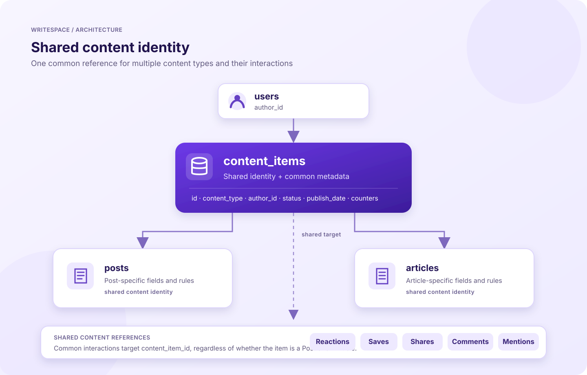

# Content Model

## Purpose

This document explains how Writespace represents content in the database and why Posts and Articles share a common identity. It focuses on the relationship between the shared `content_items` record, the type-specific Post and Article records, and the interactions that can be attached to either content type.

The goal is to describe the model that exists in the current backend, not to prescribe a future system. Implementation details that belong to individual modules are linked at the end.

## 1. Why a shared content identity?

Posts and Articles are different types of content. They have different fields and can have different creation, editing, media, and publishing rules. However, the platform also needs to support capabilities that apply to both of them:

- Reactions
- Comments and replies
- Saves
- Shares
- Publication state and publication metadata
- Common counters, such as reactions, comments, and shares

If each content type had its own independent interaction tables, the backend would need separate paths for Post reactions, Article reactions, Post saves, Article saves, and so on. That would duplicate a lot of behavior and make new content types more expensive to add.

Writespace addresses this by giving each Post or Article a shared identity in `content_items`. Type-specific details remain in their own tables, while common interactions refer to the shared content ID.

## 2. The model at a glance



The central relationships are:

1. A user can author multiple content items.
2. A content item represents the shared identity and common state of one piece of content.
3. A Post or Article record stores fields specific to that content type and uses the content item ID as its identity.
4. Generic interaction records refer to `content_item_id`, so the same interaction model can support either type.
5. Post-specific media remains associated with the Post record rather than being treated as a generic interaction.

The diagram is a conceptual view of the main relationships. For exact columns, indexes, foreign-key names, and constraints, see [Database Schema](../database/schema.md).

## 3. `content_items`: the shared identity layer

The `content_items` table is the common record for content published on Writespace. It does not replace the Post or Article tables. Instead, it provides a stable identity and shared metadata that other parts of the application can reference without needing to know every type-specific field.

The current schema includes these responsibilities:

| Field            | Purpose                                                  |
| ---------------- | -------------------------------------------------------- |
| `id`             | Shared identifier for the content item.                  |
| `content_type`   | Identifies whether the item is a `post` or an `article`. |
| `author_id`      | Identifies the user who authored the item.               |
| `status`         | Tracks the content lifecycle state.                      |
| `scheduled_at`   | Stores a scheduled publication time when one is set.     |
| `publish_date`   | Stores the publication date.                             |
| `view_count`     | Stores the view counter.                                 |
| `reaction_count` | Stores the aggregate reaction counter.                   |
| `comment_count`  | Stores the aggregate comment counter.                    |
| `share_count`    | Stores the aggregate share counter.                      |
| `version`        | Provides a version value for the content record.         |
| `created_at`     | Records when the content item was created.               |
| `updated_at`     | Records when the content item was last updated.          |

The `content_type` value is the discriminator for the subtype. The current values are `post` and `article`.

### Why keep common fields here?

Common fields have one canonical location. For example, a generic interaction can update the shared reaction counter without having to decide whether the record belongs to `posts` or `articles` just to locate that counter.

This also gives other shared capabilities a stable reference: a comment, save, share, or reaction can refer to the same `content_item_id` regardless of the content type.

## 4. Type-specific content records

The shared identity does not mean Posts and Articles have identical data or behavior. Their type-specific data remains separate.

### Posts

The `posts` table stores Post-specific information and is associated with the corresponding shared content item. The Post module uses that shared identity when it calls generic content operations. The precise key layout is defined in the Drizzle schema.

Post-specific behavior remains in the Posts module. This includes Post content handling, Post lifecycle operations, Post media handling, queries, and preview metadata.

The `post_media` table remains Post-specific and references the Post record. This is intentional: media attached through the Post media model is not automatically a generic property of every content type.

### Articles

The `articles` table stores Article-specific information and is associated with the corresponding shared content item. In the current schema, `articles.content_item_id` is the Article row identity and references `content_items.id`.

The current Article schema includes fields for:

- Title and unique slug
- Subtitle and excerpt
- Structured content document
- Tags and estimated reading time
- Cover image URL, public ID, alt text, and credit

Article-specific rules remain in the Articles module. For example, slug generation and Article content validation should not be forced into the Post module merely because both types share an identity.

## 5. Shared interactions

The main benefit of the common identity is that shared interactions can target `content_item_id` instead of maintaining separate Post and Article implementations.

| Table               | What it represents                       | Content reference |
| ------------------- | ---------------------------------------- | ----------------- |
| `content_reactions` | A user's reaction to a content item      | `content_item_id` |
| `content_saves`     | A user's saved content item              | `content_item_id` |
| `content_shares`    | A share action for a content item        | `content_item_id` |
| `comments`          | A comment associated with a content item | `content_item_id` |
| `content_mentions`  | A user mentioned in a content item       | `content_item_id` |

Comment reactions are different: they target a comment rather than the parent content item. The `comment_reactions` table therefore relates to comments.

This distinction is important. A reaction on an Article is a content reaction; a reaction on a comment under that Article is a comment reaction.

### Example: reacting to a Post or Article

At the API and service level, the interaction operation receives the shared content item ID. The interaction layer can then work against the common reaction record rather than requiring one reaction table for Posts and another for Articles.

Conceptually:

```text
Post request                  Article request
     |                              |
     v                              v
  content_item_id                content_item_id
        \                           /
         \                         /
          v                       v
             Shared interaction layer
                       |
                       v
              content_reactions
```

The same shared identity approach applies to saves, shares, and comments where the generic content endpoints are used.

## 6. Content lifecycle

The shared content record contains the lifecycle status and publication metadata used across content types.

The current status values are:

| Status      | Meaning                                                         |
| ----------- | --------------------------------------------------------------- |
| `draft`     | Content is being prepared and is not yet published.             |
| `scheduled` | Content is intended to be published at a specified future time. |
| `published` | Content has been published.                                     |

`scheduled_at` stores the scheduled time when applicable, while `publish_date` stores the publication date.

The shared lifecycle fields provide a common place to represent publication state. They do not eliminate type-specific validation: Posts and Articles can still have different content validation and command logic.

## 7. Important consistency rules

The model relies on a few important invariants:

### Content identity must be valid

A Post or Article subtype record must be associated with an existing `content_items` record. The shared content identity is the reference used by common interactions.

### The discriminator must match the subtype

A Post must correspond to a content item whose `content_type` is `post`. An Article must correspond to a content item whose `content_type` is `article`.

A normal foreign key confirms that the referenced content item exists; by itself, it does not prove that the discriminator matches the subtype table. The application must enforce this type consistency when creating or operating on content. Database-level enforcement can be considered separately if the schema later requires it.

### New interactions must target valid content

Before creating a new reaction or other interaction, the application should verify that the target content item exists and is eligible for that operation. For example, the generic reaction flow checks that the item is published and that the matching subtype exists before accepting a new or changed reaction.

Removal behavior can have different rules from creation behavior. For example, a user may need to remove an existing reaction even after the content is no longer published.

### Counters must stay consistent

The counters on `content_items` are aggregate values. Changes to reaction, comment, or share records must keep the corresponding counter in sync. Operations that can race with one another need appropriate transactional handling and concurrency protection.

## 8. What this design does and does not mean

**It does mean:**

- Posts and Articles have a common content identity.
- Shared interactions can work with both types through `content_item_id`.
- Common lifecycle metadata and counters have a shared location.
- Type-specific fields and rules remain in their own tables and modules.

**It does not mean:**

- Posts and Articles have the same schema.
- Every content-related table is generic. For example, `post_media` is still Post-specific.
- Every module has been merged into one content module.
- A valid foreign key alone guarantees that the content type matches its subtype.
- Future content types can be added without defining their own schema and domain rules.

## 9. Adding another content type

A future content type can follow the same general pattern, but it should only be added when there is a real product requirement.

At a high level, adding one would require:

1. Add the new value to the content type enum.
2. Create a type-specific table referencing `content_items`.
3. Add the new table and its relations to the Drizzle schema exports.
4. Implement type-specific validation, lifecycle, commands, and queries.
5. Ensure shared interaction operations recognize and validate the new subtype.
6. Add tests for subtype consistency, lifecycle rules, interactions, and counters.
7. Update this document and the database schema documentation.

This keeps common behavior reusable without pretending that every content type has identical requirements.

## Related documentation

- [Architecture Overview](overview.md)
- [Database Schema](../database/schema.md)
- [Posts and Articles](../modules/posts-and-articles.md)
- [Interactions](../modules/interactions.md)
- [Background Jobs](../operations/background-jobs.md)
