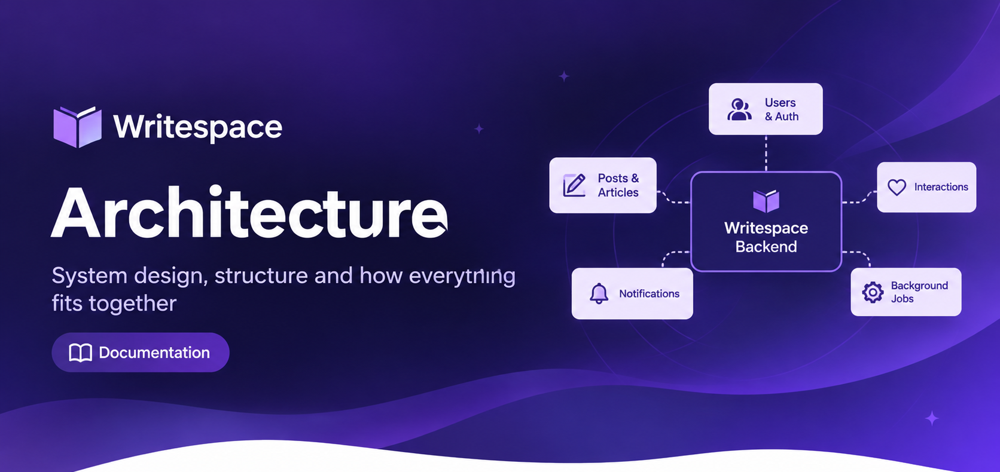
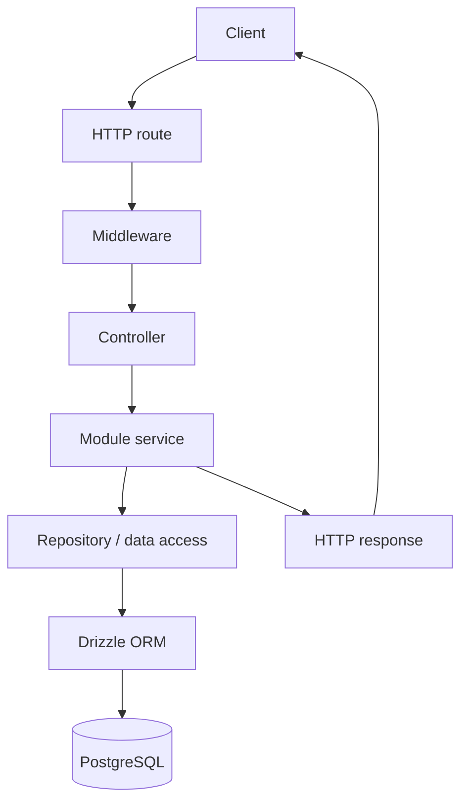
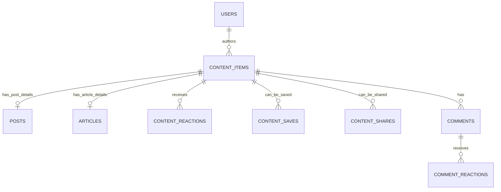
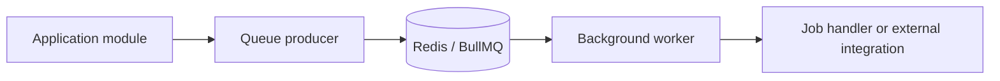

# Writespace Backend Architecture

## Purpose

This document gives a high-level view of the Writespace backend: its main modules, the path a request takes through the application, how content is represented, and where background processing fits in.

It is an entry point to the more focused documents in `docs/`. It intentionally stays at system level; detailed table definitions and module-specific flows belong in their respective documents.

## Architecture at a glance

Writespace is organized as a modular backend application. The application has a shared HTTP entry point and separates business responsibilities into domain modules such as authentication, users, Posts, Articles, interactions, and notifications. Shared infrastructure provides database access, middleware, queues, workers, and integrations used by those modules.

The main architectural building blocks are:

| Building block                  | Responsibility                                                                                                                 |
| ------------------------------- | ------------------------------------------------------------------------------------------------------------------------------ |
| HTTP application and routes     | Accept requests and direct them to the relevant module.                                                                        |
| Middleware                      | Handle cross-cutting request concerns such as authentication, validation, rate limiting, uploads, logging, and error handling. |
| Controllers                     | Translate HTTP requests into module operations and shape HTTP responses.                                                       |
| Services and domain logic       | Coordinate use cases and enforce application or domain rules.                                                                  |
| Repositories and Drizzle schema | Read and write persisted application data.                                                                                     |
| PostgreSQL                      | Store users, content, interactions, notifications, and related records.                                                        |
| Redis and BullMQ                | Provide queue infrastructure for asynchronous jobs.                                                                            |
| Workers                         | Process queued work outside the synchronous request path.                                                                      |

## High-level request flow

A typical synchronous API request moves through the HTTP layer and into the relevant module. The exact implementation can vary by use case, but the intended separation is:

Middleware is responsible for cross-cutting concerns; controllers should remain thin and delegate application work to services. Data access is handled through the database layer rather than being duplicated across HTTP handlers.

## Backend modules

The main business modules are grouped under `src/modules/`.

| Module         | Responsibility                                                                     |
| -------------- | ---------------------------------------------------------------------------------- |
| `auth`         | Authentication-related operations and request flows.                               |
| `users`        | User-facing account operations and user data management.                           |
| `posts`        | Post-specific content behavior, lifecycle, media, queries, and previews.           |
| `articles`     | Article-specific content behavior, lifecycle, slugs, media, queries, and previews. |
| `interactions` | Shared reactions, comments, saves, shares, follows, and interaction events.        |
| `notification` | Notification-related application behavior.                                         |

The modules are separated by responsibility, but they are part of the same backend application. Shared behavior is placed in common infrastructure or shared services rather than copied into each module.

## Shared content model

Posts and Articles are different content types, but both participate in common platform capabilities. The database therefore uses `content_items` as the shared identity for content.

At a high level:

- `content_items` holds common content identity and lifecycle metadata, including the content type and author.
- `posts` stores Post-specific fields and references its content item.
- `articles` stores Article-specific fields and references its content item.
- Generic interaction records reference `content_item_id`, allowing the same interaction model to apply to either content type.
- Comments also reference the shared content identity; comment reactions remain a separate interaction on comments.

This is a conceptual relationship diagram. The database schema and its foreign-key details are documented separately in `database/schema.md`.

## Background processing

Not every operation needs to complete within the lifetime of an HTTP request. Writespace uses BullMQ with Redis-backed queues and dedicated workers for background work.

The current codebase contains queue and worker components for email, media, and notifications. Queue producers add jobs; workers process those jobs independently from the request handler that initiated them.

The exact job payloads, retry behavior, idempotency requirements, and failure handling should be documented with each queue in `operations/background-jobs.md`.

## Shared infrastructure

The `src/shared/` and `src/config/` areas contain infrastructure used by multiple modules. This includes middleware, queue and worker implementations, upload handling, logging, validation, and application configuration.

The database schema is maintained under `src/db/schema/` and is configured through Drizzle Kit. PostgreSQL is the persistent data store; Redis is used by the BullMQ job infrastructure.

## Design principles

The current structure follows a few practical principles:

1. **Separate shared identity from type-specific data.** Posts and Articles share a content identity while retaining their own fields and domain rules.
2. **Reuse common interactions.** Reactions, saves, shares, and comments operate against the shared content identity where appropriate.
3. **Keep responsibilities focused.** Controllers handle HTTP concerns; services coordinate use cases; repositories handle persistence.
4. **Move suitable work out of the request path.** Background workers process queued jobs independently.
5. **Keep documentation aligned with the code.** A documented feature should be marked as implemented only when the corresponding behavior exists in the repository.

## Related documentation

- [Content model](content-model.md) — detailed content identity and Post/Article relationships.
- [Database schema](../database/schema.md) — tables, relations, indexes, and constraints.
- [Posts and Articles](../modules/posts-and-articles.md) — content module behavior.
- [Interactions](../modules/interactions.md) — reactions, comments, saves, and shares.
- [Background jobs](../operations/background-jobs.md) — queues and workers.

Some linked documents are planned and will be added as the documentation set is completed.
