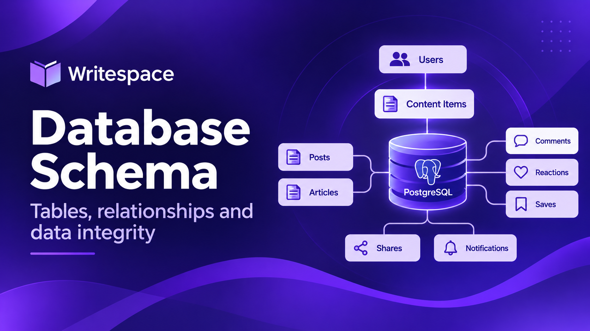
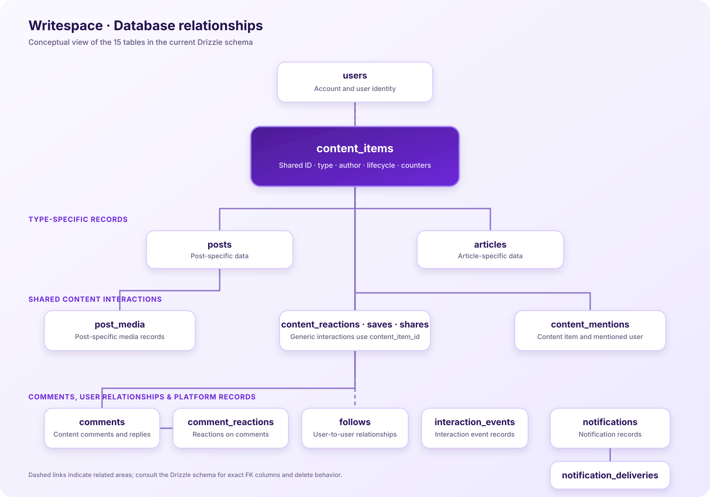

# Database Schema

## Purpose

This document describes the database structure used by the Writespace backend. It groups the current Drizzle schema by responsibility, explains the shared content relationships, and records the constraints and indexes that support the main access patterns.

The schema is defined in `src/db/schema/`. The Drizzle entry point is `src/db/schema/index.ts`, and `src/db/schema/relations.ts` describes ORM-level relations used by Drizzle queries.

> **Source of truth:** The TypeScript schema files are authoritative. This document is an explanatory guide and should be updated whenever those definitions change. For exact column types, defaults, foreign-key names, and delete actions, refer to the corresponding schema file.

## 1. Schema overview

The current Drizzle schema contains 15 database tables. They fall into four practical groups:

1. Identity and user relationships
2. Content and content-specific data
3. Shared interactions
4. Notifications and interaction events



The diagram is a conceptual overview of the main relationships. It intentionally omits some implementation details to keep the model readable. Use the schema files for exact foreign-key definitions and index expressions.

## 2. Table inventory

| Group         | Table                     | Responsibility                                                       |
| ------------- | ------------------------- | -------------------------------------------------------------------- |
| Identity      | `users`                   | Stores user accounts and profile/account attributes.                 |
| Identity      | `follows`                 | Represents a relationship between one user and another.              |
| Content       | `content_items`           | Shared identity and common lifecycle metadata for a content item.    |
| Content       | `posts`                   | Post-specific record linked to a shared content item.                |
| Content       | `articles`                | Article-specific record linked to a shared content item.             |
| Content       | `post_media`              | Media records attached to Posts.                                     |
| Content       | `content_mentions`        | User mentions associated with a content item.                        |
| Interactions  | `comments`                | Comments and replies associated with shared content.                 |
| Interactions  | `content_reactions`       | User reactions to Posts or Articles through the shared content ID.   |
| Interactions  | `comment_reactions`       | User reactions to comments.                                          |
| Interactions  | `content_saves`           | Records of content saved by users.                                   |
| Interactions  | `content_shares`          | Records of content shares and their platform.                        |
| Notifications | `notifications`           | Stores notification records.                                         |
| Notifications | `notification_deliveries` | Tracks notification delivery records.                                |
| Events        | `interaction_events`      | Stores interaction event records used by the interaction/event flow. |

`content-document.ts` is a schema helper for the structured content document; it is not one of the 15 database tables.

## 3. Identity and user relationships

### `users`

The users table is the identity root for the application. Other records refer to users when they need to identify an author, actor, recipient, commenter, follower, or the user who created an interaction.

The table contains the account and profile fields maintained by the Users and Authentication modules. Its full field list is defined in `src/db/schema/users.ts`.

### `follows`

The follows table represents a directed relationship between users. A follow connects a source user to a target user; it is not a content interaction and does not reference `content_items`.

The schema defines foreign-key relationships to `users` for both participants. The repository is responsible for enforcing the intended follow behavior and preventing invalid self-follow or duplicate relationship states according to the application rules.

## 4. Shared content identity

### `content_items`

`content_items` is the common identity layer for Posts and Articles. It allows features that apply to both content types to refer to one stable identifier.

The current schema has 13 columns:

| Column           | Purpose                                                |
| ---------------- | ------------------------------------------------------ |
| `id`             | UUID primary key and shared content identifier.        |
| `content_type`   | Discriminator identifying `post` or `article`.         |
| `author_id`      | User who authored the content item.                    |
| `status`         | Lifecycle state: `draft`, `scheduled`, or `published`. |
| `scheduled_at`   | Scheduled publication timestamp, when applicable.      |
| `publish_date`   | Publication timestamp/date.                            |
| `view_count`     | Aggregate view counter.                                |
| `reaction_count` | Aggregate reaction counter.                            |
| `comment_count`  | Aggregate comment counter.                             |
| `share_count`    | Aggregate share counter.                               |
| `version`        | Content version value.                                 |
| `created_at`     | Record creation timestamp.                             |
| `updated_at`     | Last update timestamp.                                 |

The author reference points to `users`. The table also has indexes supporting status/publication queries and author/creation-time queries.

### `posts`

The posts table stores the Post-specific portion of a content item. Its shared identity is linked to `content_items`. Post-specific logic remains in the Posts module rather than being moved into the generic content layer.

Post media is represented separately by `post_media`.

### `articles`

The articles table stores Article-specific fields while using `content_item_id` as its primary identity and a foreign key to `content_items.id`.

The current Article schema includes:

- `content_item_id`
- `title` and `slug`
- `subtitle` and `excerpt`
- `content_document`
- `tags` and `read_time`
- Cover image URL, public ID, alt text, and credit

The Article slug has a uniqueness constraint. Article-specific validation, slug generation, media handling, and lifecycle operations remain in the Articles module.

### `post_media`

Post media is deliberately Post-specific. Each media row belongs to a Post and includes the media URL, optional storage public ID, position, optional alt text, and creation timestamp.

A unique constraint on the Post and position pair prevents two media records from occupying the same position within one Post. Additional indexes support Post media lookup.

### `content_mentions`

Content mentions associate a content item with a mentioned user. The table references both `content_items` and `users`.

A unique index on `(content_item_id, mentioned_user_id)` prevents duplicate mention records for the same user in the same content item. A user/creation-time index supports retrieving mentions for a user in chronological order.

## 5. Shared interactions

The interaction tables use the shared content identifier where the interaction belongs to a Post or Article. This is the database-level foundation for keeping the interaction implementation reusable across content types.

### `content_reactions`

Stores a user's reaction to a content item. The composite primary key is `(content_item_id, user_id)`, which allows one current reaction per user per content item. The reaction value is constrained by the `reaction_type` enum.

The current reaction values are:

- `like`
- `love`
- `laugh`
- `celebrate`
- `support`
- `sad`
- `angry`

The table references `content_items` and `users`.

### `content_saves`

Stores saved content items. Its composite primary key is `(content_item_id, user_id)`, preventing the same user from saving the same content item more than once.

An index on user and creation time supports listing a user's saved content in time order.

### `content_shares`

Stores share activity for content items. Each record identifies the user, content item, platform, and creation time.

Indexes support user/content/platform lookups and content share history ordered by creation time.

### `comments`

Comments reference `content_items`, not only Posts. This allows a comment thread to belong to either a Post or an Article.

The table also supports parent-child relationships for replies. The parent comment reference is self-referential, while the author reference points to `users`.

The comment query path uses indexes that support retrieving comments for a content item and ordering them by creation time and identifier. Parent-child consistency—such as requiring a reply's parent to belong to the same content item—is enforced by repository/application logic in addition to the database references.

### `comment_reactions`

Stores reactions to comments. These records target a comment rather than a content item, so they are separate from `content_reactions`.

The table references the comment and the user who reacted. The allowed reaction values are shared with the content reaction model through the `reaction_type` enum.

## 6. Notifications and events

### `notifications`

Stores notification records generated by application activity. The notification schema is maintained separately from the delivery mechanism so notification creation and delivery can evolve independently.

The notification entity model supports generic content references where relevant, rather than assuming every notification concerns a Post.

### `notification_deliveries`

Stores delivery-related records associated with notifications. This separation allows the system to track delivery work independently from the notification itself.

### `interaction_events`

Stores interaction event records used by the interaction event pipeline. The event mapper translates application-level interaction information into the persisted event representation. Event records should not be confused with the primary interaction records: for example, a reaction is stored in `content_reactions`, while an event records activity for downstream handling.

## 7. Important constraints and indexes

The schema uses primary keys, foreign keys, unique constraints, and indexes to protect relationships and support common queries.

| Area                | Constraint or index purpose                                                                    |
| ------------------- | ---------------------------------------------------------------------------------------------- |
| Content identity    | UUID primary key on `content_items`.                                                           |
| Content type        | Enum restricts the supported content type values.                                              |
| Content lifecycle   | Enum restricts lifecycle status values.                                                        |
| Article identity    | `articles.content_item_id` is both the subtype primary key and a reference to `content_items`. |
| Article slug        | Unique slug constraint.                                                                        |
| Post media ordering | Unique Post/position pair.                                                                     |
| Mentions            | Unique content item/mentioned user pair.                                                       |
| Content reactions   | Composite content item/user primary key.                                                       |
| Content saves       | Composite content item/user primary key.                                                       |
| Content shares      | Supporting indexes for user/content/platform and content/creation-time access.                 |
| Comments            | Indexes for content item, parent comment, creation time, and identifier query patterns.        |
| User relationships  | Foreign keys connect follow participants to users.                                             |

Foreign-key delete behavior is defined in the individual Drizzle table declarations. Do not assume that every relationship cascades: for example, the content author reference is restrictive, while many dependent content and interaction records use cascading deletion. Check the relevant schema declaration before changing deletion behavior.

## 8. Schema source files

The current schema is organized under `src/db/schema/`:

| File                         | Responsibility                              |
| ---------------------------- | ------------------------------------------- |
| `index.ts`                   | Exports the active schema definitions.      |
| `relations.ts`               | Defines Drizzle ORM relations.              |
| `users.ts`                   | User table.                                 |
| `follows.ts`                 | Follow relationships.                       |
| `content-items.ts`           | Shared content identity.                    |
| `content-document.ts`        | Structured content document type/helper.    |
| `posts.ts`                   | Post-specific table.                        |
| `articles.ts`                | Article-specific table.                     |
| `post-media.ts`              | Post media records.                         |
| `content-mentions.ts`        | Content mentions.                           |
| `comments.ts`                | Comments and replies.                       |
| `content-reactions.ts`       | Shared content reactions and reaction enum. |
| `comment-reactions.ts`       | Comment reactions.                          |
| `content-saves.ts`           | Saved content records.                      |
| `content-shares.ts`          | Content share records.                      |
| `notifications.ts`           | Notifications.                              |
| `notification-deliveries.ts` | Notification delivery records.              |
| `interaction-events.ts`      | Interaction event records.                  |

Drizzle Kit is configured to use `src/db/schema/index.ts` as its schema entry point. This ensures that the active schema is driven by explicit exports rather than independently scanning every file in the schema directory.

## 9. Working with schema changes

When changing the database model:

1. Update the relevant schema file under `src/db/schema/`.
2. Update `relations.ts` when ORM-level relations change.
3. Update `index.ts` when adding or removing a schema export.
4. Review repositories and services that read or write the affected tables.
5. Generate or apply the database change using the project's Drizzle scripts.
6. Verify the generated SQL and test the affected use cases.

Useful project commands include:

```bash
# Generate a migration from schema changes
npm run db:generate

# Push the current schema to a development database
npm run db:push
```

`db:push` applies schema changes directly and is intended for development workflows. For environments that rely on migration history, review and apply migrations through the established deployment process rather than treating a local schema push as a production migration strategy.

## Related documentation

- [Architecture Overview](../architecture/overview.md)
- [Content Model](../architecture/content-model.md)
- [Posts and Articles](../modules/posts-and-articles.md)
- [Interactions](../modules/interactions.md)
- [Migrations](migrations.md)
