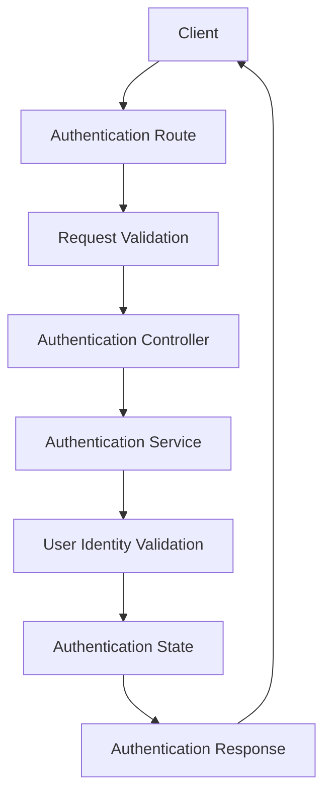
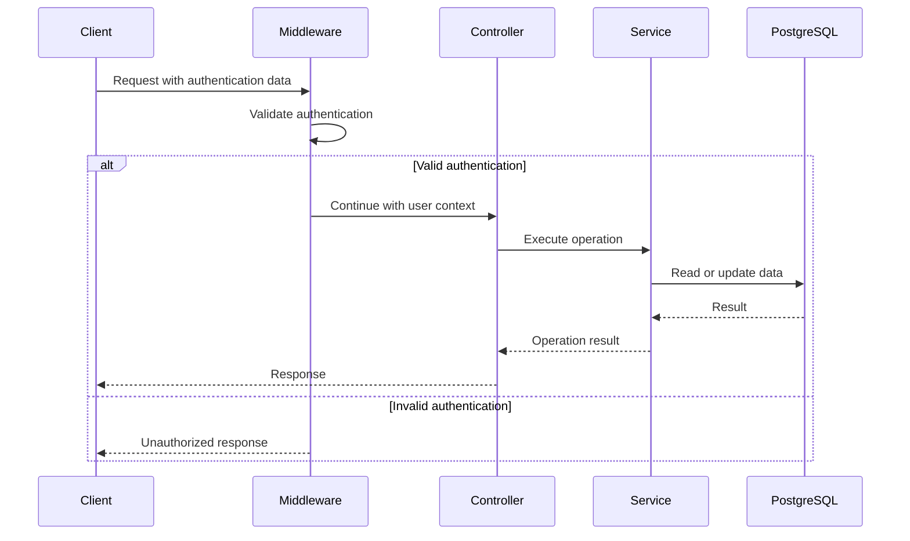
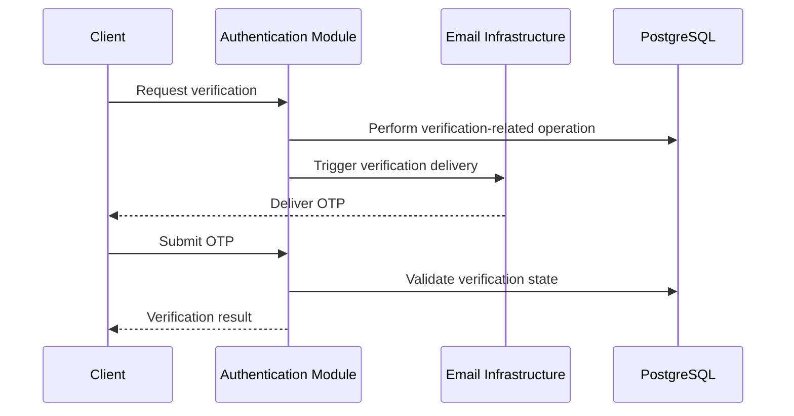
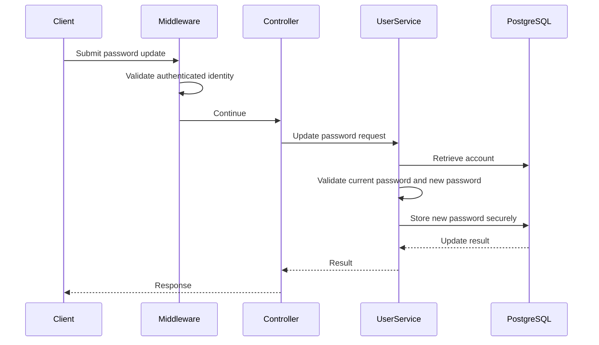

# Authentication and Users

## Purpose

This document explains how authentication and user management are organized in the Writespace backend.

Authentication and Users are closely related, but they have different responsibilities:

- The Authentication module handles identity verification and authentication-related operations.
- The Users module handles user account information and user-related operations.

Keeping these responsibilities separate helps prevent authentication logic from becoming mixed with general user management.

This document describes the module boundaries, request flows, validation responsibilities, and security considerations.

## 1. Module overview

Writespace maintains two separate modules:

```text
src/modules/
│
├── auth/
│   ├── dtos/
│   │   ├── password-reset.dto.ts
│   │   └── verify-otp.dto.ts
│   ├── auth.controller.ts
│   ├── auth.routes.ts
│   └── auth.service.ts
│
└── users/
    ├── dtos/
    │   └── update-password.dto.ts
    ├── interface/
    │   └── user.interface.ts
    ├── user.controller.ts
    ├── user.routes.ts
    └── user.service.ts
```

The modules have separate responsibilities, but both operate around the same user identity stored in the database.

## 2. Authentication module

Located in:

```text
src/modules/auth/
```

The Authentication module is responsible for authentication-related workflows.

Its main responsibilities include:

- Handling authentication requests.
- Validating authentication-related inputs.
- Coordinating identity verification.
- Handling OTP verification.
- Managing password reset workflows.
- Integrating with the user data layer where required.
- Working with the authentication middleware used by protected routes.

### 2.1 Authentication controller

File:

```text
src/modules/auth/auth.controller.ts
```

The controller acts as the HTTP entry point for authentication operations.

Its responsibilities include:

- Receiving authentication requests.
- Extracting request data.
- Calling the appropriate authentication service methods.
- Returning appropriate HTTP responses.

The controller should not independently implement password verification, user lookup, or other business rules.

Those responsibilities belong to the service layer.

### 2.2 Authentication routes

File:

```text
src/modules/auth/auth.routes.ts
```

This file defines the HTTP endpoints exposed by the Authentication module.

It connects incoming requests to the appropriate controller methods and applies the relevant middleware.

Authentication route definitions should remain centralized here rather than being spread across unrelated modules.

### 2.3 Authentication service

File:

```text
src/modules/auth/auth.service.ts
```

The authentication service contains the main authentication-related application logic.

It coordinates operations involving user identity and authentication state.

The service is responsible for handling the relevant business workflows rather than delegating those responsibilities to the controller.

### 2.4 Authentication DTOs

Located in:

```text
src/modules/auth/dtos/
```

The current module includes:

| File                    | Responsibility                                     |
| ----------------------- | -------------------------------------------------- |
| `password-reset.dto.ts` | Defines and validates password-reset request data. |
| `verify-otp.dto.ts`     | Defines and validates OTP verification input.      |

These DTOs establish the expected input structure before requests reach the authentication service.

## 3. Authentication lifecycle

Authentication is more than checking whether a user has entered the correct credentials.

A complete authentication flow involves validating identity, establishing an authenticated context, and ensuring that subsequent protected requests can be associated with the correct user.

The general request flow is:



The exact credential, token, cookie, and session mechanisms should be understood from the current implementation in `auth.service.ts` and the authentication middleware. This diagram describes the separation of responsibilities, not a specific authentication protocol.

### 3.1 Identity verification

The authentication flow must establish that the person making the request is associated with a valid user account.

The service should be responsible for coordinating the required validation and identity checks.

Invalid credentials or invalid account states must not result in an authenticated request context.

### 3.2 Authentication state

After successful authentication, the application must establish a mechanism for recognizing the user on subsequent requests.

This is where authentication state and authentication middleware work together.

The middleware must validate the incoming authentication information before allowing protected routes to proceed.

### 3.3 Protected requests

Protected routes require an authenticated user context.

The request flow is conceptually:



The important distinction is that controllers should not independently decide whether an incoming authentication token or session is valid.

That responsibility belongs to the authentication middleware and authentication layer.

## 4. OTP verification

Writespace includes OTP verification functionality as part of its authentication-related workflows.

The relevant input validation is maintained in:

```text
src/modules/auth/dtos/verify-otp.dto.ts
```

OTP verification is intended to establish that a user has access to the relevant verification channel before a protected account operation is completed.

A conceptual verification flow is:



The exact sequence of OTP generation, persistence, expiry, attempt limits, and consumption must follow the implementation in the authentication service and its supporting infrastructure.

These details should not be assumed solely from the presence of an OTP DTO.

### Important OTP security considerations

OTP workflows should account for:

- Expiration time.
- Single-use verification codes.
- Attempt limits.
- Rate limiting.
- Secure generation.
- Protection against code reuse.
- Appropriate error responses.
- Avoiding OTP exposure in logs.

These are security requirements to verify against the implementation, not claims that every control is already implemented.

## 5. Password reset

Password reset allows a user to recover access to an account when they can no longer authenticate using their existing password.

The current validation structure includes:

```text
src/modules/auth/dtos/password-reset.dto.ts
```

The password reset workflow should be separated into its individual responsibilities:

1. Accept a reset request.
2. Validate the identity or recovery mechanism.
3. Verify the reset authorization.
4. Validate the new password.
5. Update the stored password securely.
6. Invalidate any reset credentials or tokens that should no longer be usable.

The exact verification mechanism and reset sequence are defined by the current authentication implementation.

A password reset must not allow an arbitrary user to change another user's password simply by supplying their user ID.

## 6. Users module

Located in:

```text
src/modules/users/
```

The Users module handles operations associated with user accounts and user data.

Its responsibilities are different from the Authentication module.

While authentication determines whether a request is associated with a valid identity, the Users module manages operations performed on that user's account.

### 6.1 User controller

File:

```text
src/modules/users/user.controller.ts
```

The controller exposes user-related operations over HTTP.

It receives requests, obtains the relevant authenticated user context, calls the user service, and returns the result.

### 6.2 User routes

File:

```text
src/modules/users/user.routes.ts
```

This file defines the endpoints associated with user operations.

Protected user operations should use the appropriate authentication middleware so that the service receives an authenticated user context.

### 6.3 User service

File:

```text
src/modules/users/user.service.ts
```

The user service coordinates user-related operations.

This includes user account operations and password management functionality that belongs to the Users module.

Keeping account-management behavior here prevents the Authentication module from becoming responsible for every user-related operation.

### 6.4 User interface

File:

```text
src/modules/users/interface/user.interface.ts
```

This file contains user-related interfaces and contracts used by the module.

These interfaces help maintain consistency between different layers without requiring controllers and services to depend directly on unrelated implementation details.

## 7. Password management

Password-related functionality has a clear separation between authentication and user account management.

The current update-password DTO is located at:

```text
src/modules/users/dtos/update-password.dto.ts
```

It was moved from the Authentication module into the Users module to better reflect its responsibility.

This distinction is important:

| Operation                                  | Responsible module |
| ------------------------------------------ | ------------------ |
| Authentication and credential verification | Auth               |
| OTP verification                           | Auth               |
| Password recovery and reset                | Auth               |
| Authenticated password update              | Users              |
| General user account operations            | Users              |

### Updating a password

An authenticated password update should follow a flow similar to:



The implementation should ensure that:

- The current password is verified where the operation requires it.
- The new password satisfies configured validation rules.
- Passwords are never stored as plaintext.
- Password hashes are generated using an appropriate password-hashing algorithm.
- Sensitive password information is never returned in API responses.
- Existing authentication sessions are handled according to the application's session invalidation policy.

The exact behavior should be verified against `user.service.ts`.

## 8. Authentication vs authorization

Authentication and authorization solve different problems.

**Authentication** answers:

> Who is making this request?

**Authorization** answers:

> Is this user allowed to perform this operation?

For example, a user may be successfully authenticated but still not be allowed to update another user's profile or modify content they do not own.

The application should enforce authorization at the appropriate service or domain boundary rather than assuming that authentication alone grants access to every resource.

A simplified distinction:

| Concern                       | Authentication | Authorization |
| ----------------------------- | -------------- | ------------- |
| Verify user identity          | Yes            | No            |
| Validate authentication state | Yes            | No            |
| Establish request identity    | Yes            | No            |
| Check resource ownership      | No             | Yes           |
| Verify operation permissions  | No             | Yes           |
| Enforce role-based access     | No             | Yes           |

## 9. Authentication middleware

The shared authentication middleware is located at:

```text
src/shared/middlewares/auth.middleware.ts
```

It provides authentication handling across protected routes.

Rather than repeating authentication checks in every controller, the middleware acts as a common request-processing layer.

Its responsibilities include:

- Extracting the configured authentication information.
- Validating the authentication state.
- Establishing the authenticated user context.
- Rejecting requests that do not satisfy authentication requirements.
- Passing authenticated requests to the next middleware or route handler.

This keeps authentication checks consistent throughout the application.

The middleware should also avoid exposing sensitive authentication information in error messages or logs.

## 10. Error handling and validation

Authentication-related operations require careful error handling because they deal with sensitive account information.

Important scenarios include:

| Scenario                    | Expected handling                                  |
| --------------------------- | -------------------------------------------------- |
| Missing authentication      | Reject protected request.                          |
| Invalid authentication      | Reject request without exposing sensitive details. |
| Invalid OTP                 | Return verification failure.                       |
| Expired OTP                 | Reject expired verification attempt.               |
| Invalid reset authorization | Reject password reset.                             |
| Invalid password input      | Return validation error.                           |
| User does not exist         | Return an appropriate account-related response.    |
| Database failure            | Propagate through centralized error handling.      |

The application's shared validation middleware and error middleware should be used consistently rather than implementing unrelated error response formats inside each controller.

## 11. Security considerations

Authentication and user account management are security-sensitive parts of Writespace.

The following areas should be considered whenever these modules are modified.

### Password security

- Use secure password hashing.
- Never store passwords in plaintext.
- Avoid exposing hashes through API responses.
- Do not log passwords or sensitive credentials.

### OTP security

- Generate unpredictable verification codes.
- Enforce expiry.
- Prevent successful reuse.
- Limit repeated attempts.
- Protect verification endpoints against automated abuse.

### Session and authentication security

- Validate authentication information on protected requests.
- Apply appropriate token or session expiration.
- Handle logout and session invalidation correctly.
- Protect sensitive authentication credentials.
- Consider suspicious login activity and multiple-device scenarios.

### Account protection

- Verify authorization before modifying account information.
- Protect password changes and recovery operations.
- Avoid exposing whether an email address or account exists when doing so would enable account enumeration.
- Apply rate limiting to sensitive operations.

These considerations provide a security checklist. They should not be interpreted as confirmation that every advanced security feature has already been implemented.

## 12. Architectural boundaries

The separation of Authentication and Users should remain clear.

| Responsibility                   | Module |
| -------------------------------- | ------ |
| Authentication routes            | Auth   |
| Authentication controller        | Auth   |
| OTP verification                 | Auth   |
| Password recovery                | Auth   |
| Authentication service           | Auth   |
| User routes                      | Users  |
| User controller                  | Users  |
| User account operations          | Users  |
| Authenticated password update    | Users  |
| User interface contracts         | Users  |
| Shared authentication middleware | Shared |

A useful rule is:

**Authentication establishes the identity; Users manages the account.**

This distinction helps avoid duplicated functionality and keeps both modules maintainable.

## 13. Testing considerations

Authentication and user operations should be tested independently and through their integration boundaries.

Important scenarios include:

### Authentication tests

- Successful authentication.
- Invalid credentials.
- Missing credentials.
- Invalid or expired OTP.
- Successful OTP verification.
- Password reset authorization.
- Password reset failure.
- Invalid authentication state.

### User tests

- Retrieve user information.
- Update permitted user fields.
- Reject unauthorized account changes.
- Update password successfully.
- Reject incorrect current password where required.
- Reject invalid new passwords.
- Ensure password hashes are not exposed.

### Middleware tests

- Valid authentication.
- Missing authentication.
- Invalid authentication.
- Expired authentication.
- Correct authenticated user context.
- Protected route access.

Testing should also cover security-sensitive failure cases, not just successful operations.

## Related documentation

- [Architecture Overview](../architecture/overview.md)
- [Database Schema](../database/schema.md)
- [Posts and Articles](posts-and-articles.md)
- [Interactions](interactions.md)
- [Notifications](notifications.md)
- [Local Development](../operations/local-development.md)
