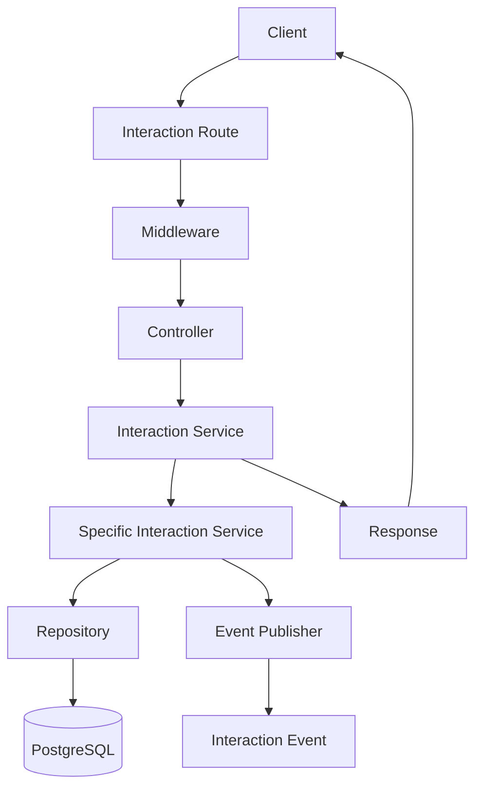
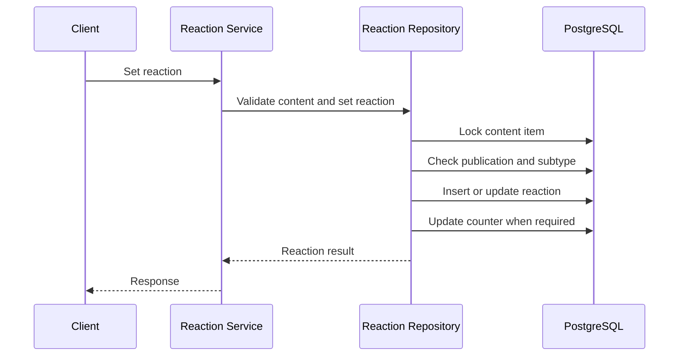
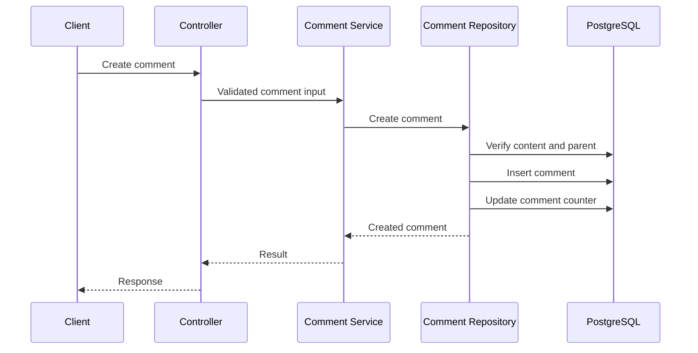
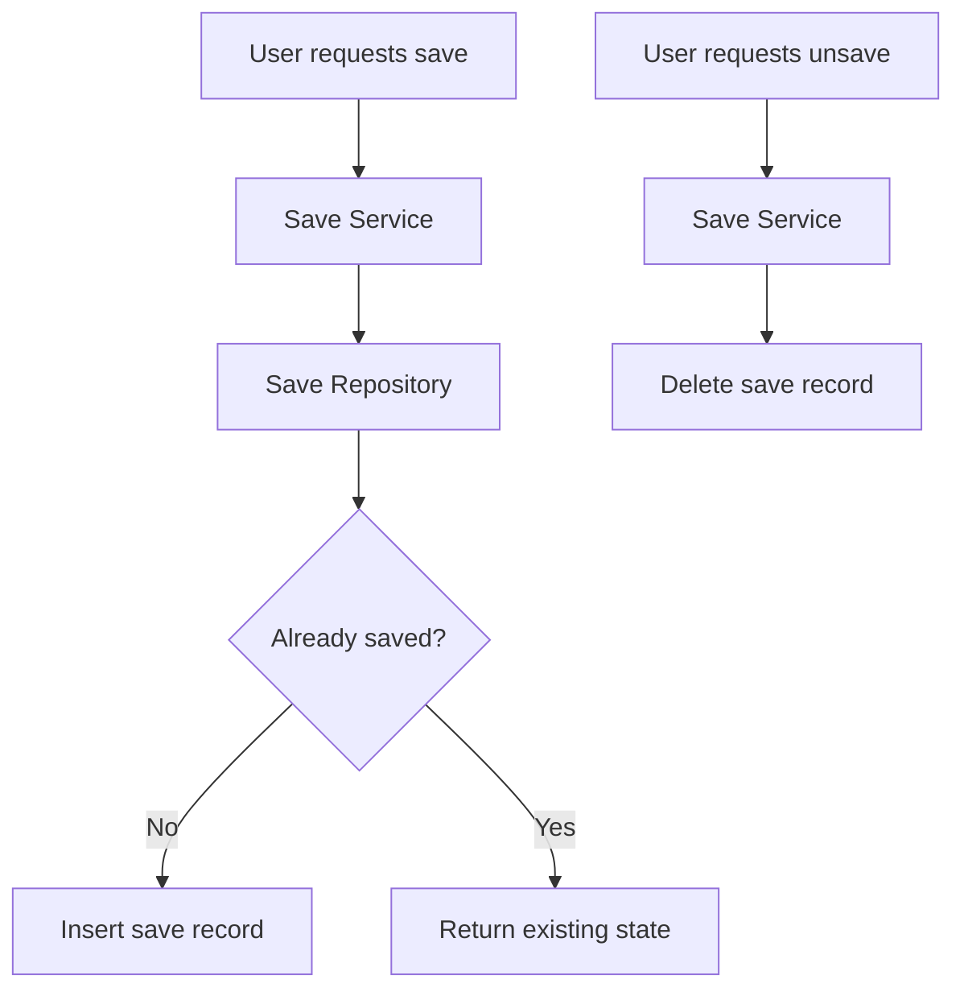
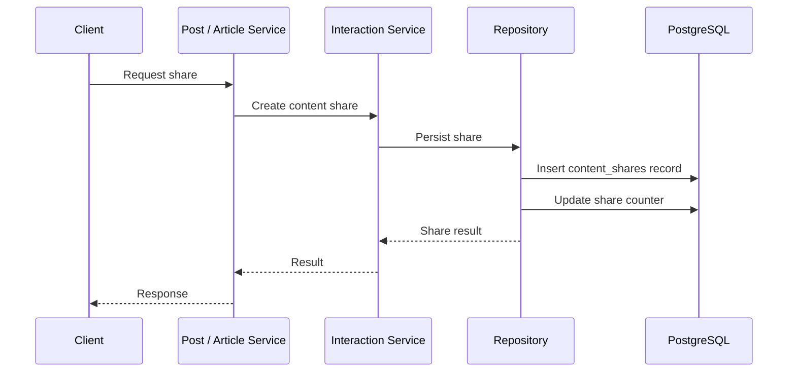

# Interactions

## Purpose

This document explains how the Writespace interaction system works and how it integrates with the shared content architecture.

Interactions allow users to engage with content through reactions, comments, saves, and shares.

Previously, several interaction operations were designed specifically around Posts. With the introduction of the shared `content_items` model, these operations have been reorganized to support both Posts and Articles through a common content identity.

The objective is to avoid maintaining separate interaction implementations for every content type while keeping the responsibilities of each interaction clear.

## 1. Interaction architecture overview

The interaction module is responsible for handling the common operations users perform on content.

The main interaction capabilities are:

| Interaction        | Purpose                                                           |
| ------------------ | ----------------------------------------------------------------- |
| Reactions          | Allow users to react to Posts and Articles.                       |
| Comments           | Allow users to comment on content and reply to existing comments. |
| Comment reactions  | Allow users to react to individual comments.                      |
| Saves              | Allow users to save content for later.                            |
| Shares             | Record content-sharing activity across platforms.                 |
| Follows            | Represent relationships between users.                            |
| Interaction events | Record interaction activity for downstream processing.            |

The main module is located at:

```text
src/modules/interactions/
```

Its high-level structure is:

```text
interactions/
│
├── contracts/
│   ├── reaction.types.ts
│   ├── save.types.ts
│   └── share.types.ts
│
├── dtos/
│
├── events/
│   ├── interaction-event.mapper.ts
│   └── interaction-event.publisher.ts
│
├── interface/
│
├── repositories/
│   ├── comment.repository.ts
│   ├── follow.repository.ts
│   ├── reaction.repository.ts
│   ├── save.repository.ts
│   └── share.repository.ts
│
├── services/
│   ├── comment.service.ts
│   ├── follow.service.ts
│   ├── reaction.service.ts
│   ├── save.service.ts
│   └── share.service.ts
│
├── interactions.controllers.ts
├── interactions.routes.ts
└── interactions.service.ts
```

The main interaction service acts as a common facade for operations consumed by other modules, while individual services and repositories own the implementation of their respective responsibilities.

## 2. Shared content identity

The interaction system uses `content_item_id` to identify the content being interacted with.

A Post and an Article have different type-specific records, but both have a shared identity in `content_items`.

For example:

```text
Post
  |
  | content_item_id
  v
content_items
  |
  v
content_reactions
```

The same relationship applies to Articles.

This means the interaction module can perform common operations without requiring separate Post and Article reaction, save, share, and comment implementations.

The shared content identity also provides a consistent reference for counters and interaction events.

## 3. Request and processing flow

A typical interaction request follows this flow:



The responsibilities are separated:

**Routes**

Define the API endpoints and connect them to their controllers.

**Controllers**

Handle HTTP-specific concerns, extract request information, invoke the appropriate service methods, and return responses.

**Interaction facade**

Provides a common entry point for interaction operations used by other modules.

**Individual services**

Implement reaction, comment, save, share, and follow use cases.

**Repositories**

Handle database queries, inserts, updates, deletes, and transaction-related persistence operations.

**Event publisher**

Publishes interaction activity for downstream processing. Event publishing is treated as a best-effort operation in the relevant interaction flows.

## 4. Reactions

Reactions allow users to express their response to a Post or Article.

The current implementation supports the following reaction types:

| Reaction  | Value       |
| --------- | ----------- |
| Like      | `like`      |
| Love      | `love`      |
| Laugh     | `laugh`     |
| Celebrate | `celebrate` |
| Support   | `support`   |
| Sad       | `sad`       |
| Angry     | `angry`     |

These values are defined through the shared PostgreSQL `reaction_type` enum.

### Database structure

Reactions to content are stored in:

```text
content_reactions
```

The important fields are:

| Column            | Purpose                         |
| ----------------- | ------------------------------- |
| `content_item_id` | Content receiving the reaction. |
| `user_id`         | User who reacted.               |
| `reaction_type`   | Selected reaction.              |
| `created_at`      | Reaction creation timestamp.    |
| `updated_at`      | Last reaction update timestamp. |

The composite primary key is:

```text
(content_item_id, user_id)
```

This ensures that a user has only one current reaction record per content item.

A user can change their reaction, but changing it does not create another reaction record.

### Setting a reaction

The generic reaction service supports setting a reaction on a content item.

The general flow is:



The repository checks that the content item exists, is published, and has the matching subtype before accepting a new or changed reaction.

### Like and unlike behavior

The generic like operation supports toggle behavior.

| Existing state   | Requested action | Result                        |
| ---------------- | ---------------- | ----------------------------- |
| No reaction      | Like             | Creates a like.               |
| Like             | Like again       | Removes the like.             |
| Love             | Like             | Changes the reaction to like. |
| Another reaction | Like             | Changes the reaction to like. |

This behavior is handled through the repository's transactional content reaction operation.

### Counter consistency

The `reaction_count` field is stored on `content_items`.

The expected counter behavior is:

- Creating a new reaction increments the counter.
- Removing an existing reaction decrements the counter.
- Changing one reaction type to another does not change the total count.

Important repository operations use transactions and row locking to protect against concurrent changes to the same content item.

### Comment reactions

Reactions on comments are handled separately from content reactions.

They are stored in:

```text
comment_reactions
```

A comment reaction targets a comment rather than the parent Post or Article.

This distinction keeps two different interaction concepts separate:

- Content reaction: reaction to a Post or Article.
- Comment reaction: reaction to an individual comment.

## 5. Comments

Comments allow users to participate in discussions associated with a Post or Article.

The current comment model uses `content_item_id` instead of relying exclusively on a Post identifier.

This allows a single comment implementation to support both content types.

### Database structure

Comments are stored in:

```text
comments
```

The table represents:

- The content item being discussed.
- The user who created the comment.
- The comment content.
- The optional parent comment.
- Creation and update timestamps.

The parent-comment reference enables replies.

### Top-level comments and replies

The comment system supports two levels of relationship:

**Top-level comments**

A comment directly associated with a content item has no parent comment.

**Replies**

A reply references another comment through `parent_comment_id`.

Conceptually:

```text
Content Item
    |
    ├── Comment A
    │      |
    │      ├── Reply A1
    │      └── Reply A2
    │
    ├── Comment B
    │      |
    │      └── Reply B1
    │
    └── Comment C
```

### Comment creation flow



### Parent comment validation

A reply must belong to the same content item as its parent comment.

For example, a user must not be able to create a reply under a comment belonging to another Article or Post by simply providing that comment's ID.

The repository checks this relationship when handling comment creation.

### Comment retrieval

The system supports retrieving top-level comments for a content item.

The database indexes support querying comments by content item and parent comment, with creation time and ID used for stable ordering.

Cursor-based or paginated retrieval should use a consistent ordering so that new comments do not cause previously returned results to be duplicated unnecessarily.

### Comment counter

The `comment_count` field on `content_items` represents the aggregate comment count.

Comment creation and other relevant comment operations must maintain this counter consistently.

The exact counter policy, including whether replies are included, should remain aligned with the repository implementation.

## 6. Saves

Saving allows a user to bookmark a Post or Article for later access.

Unlike reactions, saves do not have different types. A user either has saved a content item or has not.

### Database structure

Saved content is stored in:

```text
content_saves
```

The table contains:

| Column            | Purpose                     |
| ----------------- | --------------------------- |
| `content_item_id` | Saved content item.         |
| `user_id`         | User who saved the content. |
| `created_at`      | When the item was saved.    |

The composite primary key is:

```text
(content_item_id, user_id)
```

This prevents duplicate saves by the same user for the same content item.

### Save and unsave flow



### Saved content retrieval

The interaction system supports retrieving content saved by the current user.

The generic endpoint is:

```http
GET /saved-content
```

Saved content retrieval uses the shared content model, which means saved Posts and Articles can be handled through the same operation.

The repository supports cursor-based pagination to avoid loading the entire saved-content collection at once.

## 7. Shares

Shares represent a user's action of sharing a Post or Article through an external platform.

The system records share activity rather than implementing the sharing behavior of every external platform itself.

### Database structure

Share records are stored in:

```text
content_shares
```

The important fields are:

| Column            | Purpose                    |
| ----------------- | -------------------------- |
| `id`              | Share record identifier.   |
| `user_id`         | User performing the share. |
| `content_item_id` | Content being shared.      |
| `platform`        | Destination platform.      |
| `created_at`      | Share timestamp.           |

A share record captures an individual share action. Therefore, multiple records for the same user, content item, and platform may exist unless application-level rules explicitly prevent them.

### Share flow



### Platform-specific behavior

The sharing module can record different platform values.

The Post and Article modules remain responsible for preparing their own share destinations and content information.

For example, Article sharing can use Article-specific preview metadata, while the interaction service handles persistence through the generic content share operation.

### Share retrieval

The interaction service supports:

- Retrieving a share by ID.
- Retrieving shares for a content item.
- Retrieving a user's content share history.

Backward-compatible Post-oriented methods remain available where needed.

## 8. Follows

Follows represent relationships between users rather than interactions with content.

They are included in the interaction module because they are part of the platform's social behavior, but their data model is independent of the shared content identity.

The `follows` table references users through the follower and followed user identifiers.

The follow repository handles persistence and the service coordinates follow-related operations.

A follow does not reference `content_items`.

## 9. Interaction events

The interaction system includes an event mapping and publishing layer.

The relevant implementation is located in:

```text
src/modules/interactions/events/
```

It contains:

- `interaction-event.mapper.ts`
- `interaction-event.publisher.ts`

### Event mapping

The mapper converts application-level interaction information into the representation expected by the interaction event system.

It supports the shared content identity and retains compatibility with legacy Post-oriented event inputs where necessary.

For example, an older event that references a Post can be represented using the corresponding shared content item identity.

### Event publishing

The publisher is responsible for publishing interaction events.

In the relevant interaction service flows, event publishing is best-effort: failure to publish an event should not incorrectly imply that the primary database interaction failed after it has already succeeded.

This is an important distinction between the primary interaction operation and its secondary event side effect.

For stronger delivery guarantees, a durable outbox-based design can be considered separately. Best-effort publishing alone does not guarantee that every event will eventually be delivered.

## 10. API routes

The interaction routes are defined in:

```text
src/modules/interactions/interactions.routes.ts
```

The generic content endpoints include:

| Method   | Endpoint                           | Purpose                        |
| -------- | ---------------------------------- | ------------------------------ |
| `GET`    | `/content/:contentItemId/comments` | Retrieve comments for content. |
| `POST`   | `/content/:contentItemId/comments` | Create a comment on content.   |
| `POST`   | `/content/:contentItemId/save`     | Save a content item.           |
| `DELETE` | `/content/:contentItemId/save`     | Remove a saved content item.   |
| `GET`    | `/saved-content`                   | Retrieve saved content.        |

The module also retains existing Post-oriented endpoints and compatibility methods where applicable.

Reaction, comment-reaction, share, and follow endpoints are handled by the existing route definitions. Their exact URL patterns should be taken from the current `interactions.routes.ts` rather than inferred from the service method names.

## 11. Validation and authorization

Interaction operations must validate more than just the presence of an identifier.

Important checks include:

**Content existence**

The referenced content item must exist.

**Content type consistency**

A content item must have the expected subtype. A Post operation must not accidentally act on an Article record or vice versa.

**Publication status**

New or changed reactions must target eligible published content according to the current reaction repository rules.

**User identity**

Operations must use the authenticated user identity rather than trusting a client-supplied actor ID.

**Comment hierarchy**

A reply must reference a valid parent comment belonging to the same content item.

**Duplicate prevention**

Composite primary keys protect against duplicate content reactions and saves.

**Ownership and permissions**

Operations that modify content or moderate comments must follow the relevant authorization rules.

## 12. Concurrency and consistency

Social interactions can be submitted concurrently.

For example, two requests from the same user or two different users may attempt to modify the same content item at nearly the same time.

The interaction repositories use transactional operations and row locking for important content reaction and toggle-like operations.

This is important because the following must remain consistent:

- The reaction record.
- The aggregate reaction counter.
- The result returned to the client.

Similar consistency considerations apply to comment and share counters.

Whenever an interaction operation modifies multiple related records, the relevant writes should be performed within an appropriate database transaction.

A successful TypeScript build alone does not establish concurrency correctness. These behaviors should also be verified through integration tests that exercise competing requests.

## 13. Backward compatibility

The interaction refactoring moves the system towards generic content operations without requiring every existing caller to change at once.

Compatibility is retained in selected Post-oriented service methods and event inputs.

Examples include:

- Post-oriented share wrappers.
- Legacy Post reaction aliases.
- Existing Post comment and save routes.
- Legacy event input support.

These compatibility paths should delegate to the shared implementation where appropriate rather than reintroducing duplicate Post-specific persistence logic.

They can be removed only after all callers and API consumers have moved to the generic content interfaces.

## 14. Important implementation considerations

When modifying the interaction module, consider the following:

1. Use `content_item_id` for generic content interactions.
2. Keep comment reactions separate from content reactions.
3. Enforce one current content reaction per user and content item.
4. Protect reaction counters against concurrent updates.
5. Validate content publication state before creating or changing reactions.
6. Validate that replies belong to the same content item as their parent comments.
7. Keep saved-content retrieval paginated.
8. Distinguish share activity records from actual external platform sharing.
9. Treat best-effort event publishing as a secondary operation, not a durable delivery guarantee.
10. Preserve backward compatibility until old callers have been migrated.
11. Test both Post and Article interaction flows.
12. Test failure and concurrency scenarios, not only successful operations.

## Related documentation

- [Architecture Overview](../architecture/overview.md)
- [Content Model](../architecture/content-model.md)
- [Database Schema](../database/schema.md)
- [Posts and Articles](posts-and-articles.md)
- [Notifications](notifications.md)
- [Background Jobs](../operations/background-jobs.md)
