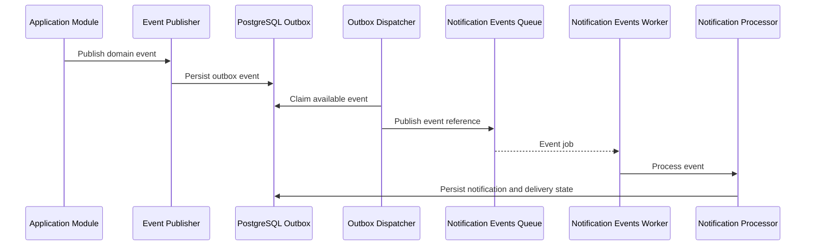
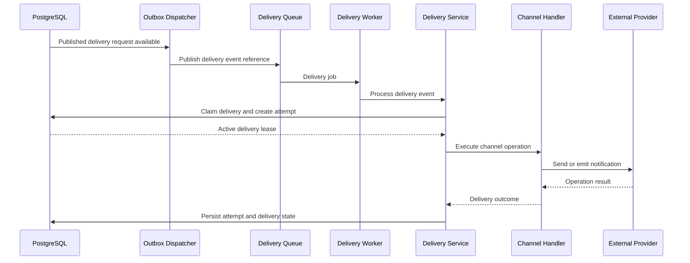

# Notifications

## Purpose

This document explains how the notification system is organized in the Writespace backend.

Notifications allow users to stay informed about activity related to their accounts and content.

Examples include:

- Someone reacts to a user's content.
- Someone follows another user.
- Someone shares content.
- An account-related event requires the user's attention.
- A notification needs to be delivered through an available channel.

The notification system separates domain-event processing, notification persistence, user inbox management and channel delivery.

This separation allows the application to maintain notification records independently from the mechanisms responsible for delivering them.

The system uses PostgreSQL for persistent notification and delivery state, BullMQ and Redis for asynchronous processing, and Socket.IO for realtime updates.

---

## 1. Notification architecture overview

The notification functionality is organized around five responsibilities:

1. **Event processing:** Receiving and validating application events.
2. **Notification creation:** Evaluating notification policies and creating the appropriate notification records.
3. **Notification persistence:** Maintaining inbox records, groups, preferences and delivery records.
4. **Channel delivery:** Sending eligible notifications through realtime or email channels.
5. **Recovery and reliability:** Handling duplicate events, retries, worker failures and queue inconsistencies.

### Relevant implementation

```text
src/modules/notification/

├── contracts/
├── domain/
├── events/
├── handlers/
├── interface/
├── realtime/
├── repositories/
├── services/
├── templates/
└── workers/
```

### Module responsibilities

| Directory       | Responsibility                                                              |
| --------------- | --------------------------------------------------------------------------- |
| `contracts/`    | Shared delivery-handler and event-envelope contracts.                       |
| `domain/`       | Event names, grouping policies and notification policies.                   |
| `events/`       | Event registry and event payload validation.                                |
| `handlers/`     | Channel-specific delivery handlers.                                         |
| `interface/`    | Notification and email-related interfaces.                                  |
| `realtime/`     | Socket.IO notification server.                                              |
| `repositories/` | Database persistence and queries.                                           |
| `services/`     | Event publishing, processing, delivery, preferences and inbox coordination. |
| `templates/`    | Transactional and notification email templates.                             |
| `workers/`      | Background event, delivery, dispatch and reconciliation workers.            |

The notification module also uses shared infrastructure such as PostgreSQL, Redis, BullMQ, the common mailer and application configuration.

---

## 2. High-level event and notification flow

A notification generally originates from an application event.

For example, when someone reacts to another user's content, the interaction module may publish a domain event.

The event is recorded in PostgreSQL and processed asynchronously.

### Domain event flow



The precise transaction boundaries depend on the event producer and notification processor.

The important distinction is that application-event creation and notification delivery are separate operations.

### Notification delivery flow



---

## 3. Main database entities

Notification records and delivery records are separate because their lifecycles are different.

### Notifications

Schema:

```text
src/db/schema/notifications.ts
```

Table:

```text
notifications
```

The notification represents the information that should be available to a recipient.

It contains information such as:

- Recipient user.
- Notification type.
- Category.
- Title and body.
- Related entity information.
- Read and lifecycle metadata.
- Creation and expiration information.

### Generic content references

Writespace supports a shared content identity through `content_items`.

A notification related to a Post or Article can reference the shared content entity rather than requiring separate notification models for each content type.

This allows notification references to remain consistent across supported content types.

### Notification groups

Schemas:

```text
src/db/schema/notification-groups.ts
src/db/schema/notification-group-events.ts
```

Tables:

```text
notification_groups
notification_group_events
```

These represent grouped notifications and the source events associated with those groups.

They support aggregation of repetitive activity, such as reactions to the same content.

### Preferences and settings

Schemas:

```text
src/db/schema/notification-preferences.ts
src/db/schema/notification-user-settings.ts
```

Tables:

```text
notification_preferences
notification_user_settings
```

These store category/channel preferences and user-level notification configuration.

### Delivery records

Schema:

```text
src/db/schema/notification-deliveries.ts
```

Table:

```text
notification_deliveries
```

A delivery represents one logical request to deliver notification information through a channel.

A notification may have multiple channel-specific delivery records.

### Delivery attempts

Schema:

```text
src/db/schema/notification-delivery-attempts.ts
```

Table:

```text
notification_delivery_attempts
```

Each actual channel attempt has a separate diagnostic record.

This makes it possible to inspect individual failures and provider responses without losing the current delivery state.

### Other supporting tables

| Table                       | Responsibility                                            |
| --------------------------- | --------------------------------------------------------- |
| `notification_suppressions` | Suppression information for notification processing.      |
| `interaction_events`        | Persistent interaction-related event information.         |
| `outbox_events`             | Durable asynchronous application and notification events. |
| `processed_events`          | Consumer-level event processing idempotency.              |

---

## 4. Notification and delivery lifecycle separation

A notification and its delivery have related but independent lifecycles.

A notification may exist even when an email or realtime delivery fails.

For example:

1. A user performs an interaction.
2. The notification processor creates a notification.
3. A corresponding channel delivery is scheduled.
4. The email provider temporarily becomes unavailable.
5. The notification remains available through the inbox even though the email attempt failed.

This separation prevents external provider availability from determining whether a notification record can exist.

### Supported delivery channels

The current delivery model defines:

- `realtime`
- `email`
- `browser_push`

The active delivery handlers currently registered are:

- Realtime.
- Email.

Browser push is represented in the delivery channel model but should not be considered an active delivery implementation until its handler and provider infrastructure are implemented.

---

## 5. Notification event processing

The event-processing infrastructure is maintained through:

```text
src/modules/notification/

├── contracts/
├── domain/
├── events/
├── services/
├── repositories/
└── workers/
```

### Event contracts and validation

The event envelope and delivery handler contracts are defined in:

```text
contracts/event-envelope.types.ts
contracts/delivery-handler.contract.ts
```

The event registry validates supported event payloads and their corresponding processing definitions.

The event schemas are maintained in:

```text
events/event.schemas.ts
events/event.registry.ts
```

This avoids relying on unvalidated queue payloads.

### Domain event names and policies

The notification domain contains:

```text
domain/event-name.ts
domain/delivery-event-name.ts
domain/notification-policy.registry.ts
domain/notification-grouping.policy.ts
```

These files centralize event naming, policy evaluation and grouping rules.

### Currently supported social events

The implemented notification policies currently include:

| Event            | Purpose                       |
| ---------------- | ----------------------------- |
| `reaction.added` | Someone reacts to content.    |
| `follow.created` | Someone follows another user. |
| `share.created`  | Someone shares content.       |

Additional event types should be treated as future work unless they are added to the event registry and corresponding processing implementation.

---

## 6. Processed-event idempotency

A durable event may be delivered to a worker more than once.

For example:

1. A worker receives an event.
2. It processes the event.
3. The worker crashes before the queue acknowledges completion.
4. BullMQ retries the job.

Without idempotency, the repeated event might create duplicate notification side effects.

Writespace uses:

```text
src/modules/notification/repositories/processed-event.repository.ts
```

Database table:

```text
processed_events
```

The logical processing identity is:

```text
consumer_name + event_id
```

This allows different consumers to track the processing of the same event independently.

### Duplicate processing behaviour

When an event has already been processed by the same consumer, another execution is recognized as a duplicate.

The processor can return a duplicate outcome without repeating the notification mutations.

The processing reservation and related database operations are coordinated transactionally.

---

## 7. PostgreSQL outbox

The notification pipeline uses a transactional outbox.

Schema:

```text
src/db/schema/outbox-events.ts
```

Table:

```text
outbox_events
```

The outbox records event identity, producer, payload, metadata, aggregate information, availability, attempts, lease ownership and dispatch outcome.

### Why use an outbox?

Writing application data and publishing a Redis job are two separate operations.

A PostgreSQL transaction cannot atomically commit a change in the database and a queue insertion in Redis.

Without an outbox, the application could:

- Commit a database transaction but fail to publish its background job.
- Publish a job before its related database transaction commits.
- Lose the connection during queue handoff without knowing whether publication succeeded.

The outbox provides a durable record of work that still needs to be dispatched.

### Outbox status

| Status       | Meaning                            |
| ------------ | ---------------------------------- |
| `PENDING`    | Awaiting dispatch.                 |
| `PROCESSING` | Claimed by a dispatcher.           |
| `PUBLISHED`  | Successfully handed off to BullMQ. |
| `FAILED`     | Dispatch attempts exhausted.       |

The outbox dispatcher is implemented in:

```text
services/outbox-dispatcher.service.ts
workers/outbox-dispatcher.worker.ts
repositories/outbox.repository.ts
```

### Queue publication

The dispatcher routes outbox events to the appropriate queue.

Domain event jobs use:

```text
notification-event-{event-id}
```

Delivery event jobs use:

```text
notification-delivery-event-{event-id}
```

These stable job identifiers are reused during handoff and recovery.

`PUBLISHED` means only that the queue handoff succeeded. It does not mean the notification was delivered.

---

## 8. Notification delivery service

The notification delivery service is located at:

```text
src/modules/notification/services/notification-delivery.service.ts
```

Its responsibilities include:

- Validating delivery-request events.
- Loading the corresponding delivery record.
- Selecting the appropriate channel handler.
- Claiming the delivery.
- Creating an actual delivery attempt.
- Executing the channel handler.
- Mapping the handler result to a persistent delivery state.
- Scheduling retryable failures.
- Persisting provider response information.

### Channel handlers

The handlers are located in:

```text
src/modules/notification/handlers/
```

#### Realtime handler

```text
notification-realtime.handler.ts
```

Responsibilities:

- Verify that the notification exists where required.
- Verify recipient ownership.
- Check notification lifecycle and expiration.
- Build the frontend notification representation.
- Emit notification events to the authenticated recipient's private room.
- Emit unread-count updates.

Realtime delivery is best effort.

A successful server-side emission does not prove that a browser received or displayed the event.

REST inbox synchronization remains authoritative when a client reconnects.

#### Email handler

```text
notification-email.handler.ts
```

Responsibilities:

- Validate the recipient.
- Load the intended recipient's email information.
- Prepare the notification email template.
- Send through the shared mailer.
- Inspect accepted and rejected recipient information.
- Classify temporary, permanent and ambiguous outcomes.

The notification email handler uses the durable notification pipeline and maintains delivery state in PostgreSQL.

This is different from the legacy authentication-email queue.

---

## 9. Delivery status and attempt outcomes

### Delivery statuses

| Status             | Meaning                                          |
| ------------------ | ------------------------------------------------ |
| `queued`           | Waiting for delivery processing.                 |
| `processing`       | Claimed by a delivery worker.                    |
| `accepted`         | Accepted by the channel transport.               |
| `delivered`        | Confirmed delivery where supported.              |
| `retryable_failed` | Temporary failure with a retry scheduled.        |
| `permanent_failed` | Permanent failure.                               |
| `suppressed`       | Intentionally not delivered.                     |
| `unknown`          | The external result cannot be determined safely. |
| `dead_lettered`    | Configured delivery attempts exhausted.          |

### Attempt outcomes

The individual attempt table records outcomes such as:

- `processing`
- `accepted`
- `delivered`
- `transient_failure`
- `permanent_failure`
- `ambiguous`
- `suppressed`

This distinction allows the system to preserve the diagnostic result of individual attempts while keeping one current status on the logical delivery.

### Transport acceptance versus delivery

An email accepted by SMTP is not necessarily present in the recipient's inbox.

Likewise, a realtime event accepted by the server's Socket.IO emission operation does not prove browser receipt.

The system preserves these distinctions instead of reporting every accepted transport operation as confirmed delivery.

---

## 10. Lease management and worker ownership

The delivery repository is located at:

```text
repositories/notification-delivery.repository.ts
```

It manages:

- Atomic delivery claims.
- Attempt creation.
- Worker ownership.
- Lease renewal.
- Attempt completion.
- Expired lease handling.

### Why use delivery leases?

A worker might become unresponsive or crash during a delivery operation.

Without ownership, another worker could begin a second delivery while the previous worker is still executing.

A delivery lease prevents multiple workers from intentionally owning the same active delivery at the same time.

### Heartbeat renewal

The delivery service periodically renews the lease while a channel handler is running.

A renewal is accepted only when:

- The delivery is still processing.
- The worker ID matches the owner.
- The attempt number matches the active attempt.
- The existing lease has not expired.

The heartbeat stops after the channel handler finishes.

### Expired lease handling

An expired lease does not prove that an external operation failed.

For example, an SMTP server might accept an email while the worker fails before it records the acceptance.

Therefore, an expired delivery attempt is resolved as:

```text
attempt outcome = ambiguous
delivery status = unknown
```

The system intentionally avoids blindly retrying this delivery.

---

## 11. Delivery preferences

Notification preference handling is implemented through:

```text
notification-preference.controller.ts
notification-preference.routes.ts

services/notification-preference.service.ts

repositories/notification-preference.repository.ts
```

### API endpoints

Retrieve preferences:

```http
GET /api/v1/notification-preferences
```

Update preferences:

```http
PATCH /api/v1/notification-preferences
```

Example request:

```json
{
  "updates": [
    {
      "category": "social",
      "enabled": false
    }
  ]
}
```

Preference values are evaluated according to category, channel and the corresponding policy configuration.

In-app notification preference controls whether the corresponding in-app inbox and realtime notification delivery is enabled.

Email delivery eligibility is evaluated independently according to the channel policy.

Preference changes are prospective. Existing inbox notifications are not automatically removed when a preference changes.

---

## 12. Notification inbox

The notification inbox provides the user-facing notification history.

The inbox implementation is located in:

```text
services/notification-inbox.service.ts

repositories/notification.repository.ts
```

The HTTP interface is provided by:

```text
notification.controller.ts
notification.routes.ts
```

### REST endpoints

List notifications:

```http
GET /api/v1/notifications
```

Retrieve unread count:

```http
GET /api/v1/notifications/unread-count
```

Retrieve an individual notification:

```http
GET /api/v1/notifications/:id
```

Mark a notification as read:

```http
PATCH /api/v1/notifications/:id/read
```

Mark all notifications as read:

```http
POST /api/v1/notifications/read-all
```

Dismiss a notification:

```http
POST /api/v1/notifications/:id/dismiss
```

Restore a notification:

```http
POST /api/v1/notifications/:id/restore
```

Delete a notification:

```http
DELETE /api/v1/notifications/:id
```

All recipient-scoped operations must use the authenticated user's identity.

A client must not be able to access another user's notification by changing the notification identifier.

---

## 13. Grouped notifications

Writespace supports grouping repetitive notification activity.

The grouping policy is maintained in:

```text
domain/notification-grouping.policy.ts
repositories/notification-group.repository.ts
```

Grouped reactions reduce excessive notification volume when several users react to the same content.

### Current reaction grouping behaviour

The grouping key uses:

- Content item identity.
- Reaction type.

The grouping window is a fixed five-minute UTC bucket.

It is not a rolling five-minute window.

Two reactions occurring close together can therefore belong to different groups if they fall on opposite sides of a bucket boundary.

### Group membership

The group-event table associates source events with their notification group.

Important characteristics:

- Group membership uses the source event identity.
- Duplicate source events are prevented.
- Group counts are based on distinct source events.
- Actor previews contain recent distinct actors.
- The frontend representation is updated when the group changes.

### Realtime group updates

A grouped notification can generate:

- An initial `notification.created` event.
- Subsequent `notification.updated` events.

These updates retain the same logical notification identity.

Unread-count updates are emitted when the relevant inbox state changes.

---

## 14. Realtime notification delivery

The Socket.IO implementation is located in:

```text
src/modules/notification/realtime/notification-socket.server.ts
```

The socket server is attached to the shared HTTP server.

### Authentication

The socket connection authenticates using the application's JWT handshake authentication.

The server assigns authenticated connections to private user rooms.

Clients cannot choose another user's room.

A private room follows the user-specific identity convention:

```text
user:{userId}
```

### Socket event names

The current notification event interface includes:

| Event                               | Purpose                                                             |
| ----------------------------------- | ------------------------------------------------------------------- |
| `notification.connection.ready`     | Indicates the connection is ready for notification synchronization. |
| `notification.created`              | A notification has been created.                                    |
| `notification.updated`              | An existing notification representation has changed.                |
| `notification.unread-count.updated` | The unread count has changed.                                       |
| `notification.sync.required`        | The client should synchronize notification state.                   |

### Reconnection behaviour

Realtime delivery is best effort.

When a client reconnects, the connection-ready event informs it that notification synchronization is required.

The client should retrieve the authoritative inbox state through the REST API.

Socket.IO events should not be treated as a permanent notification history.

### Multi-instance consideration

The current socket implementation should be treated according to its deployed Socket.IO adapter configuration.

Running multiple application instances may require a shared Socket.IO adapter, such as a Redis adapter, to distribute room events between instances.

Do not assume that private socket rooms automatically synchronize across independent application processes.

---

## 15. Notification email templates

The notification module contains the following template-related files:

```text
src/modules/notification/templates/

├── layout.ts
├── login-alert.ts
├── notification-email.ts
├── otp-verify.ts
├── password-reset.ts
├── password-update.ts
├── profile-update.ts
└── welcome.ts
```

These templates serve two related but separate email workflows.

### Transactional authentication and account emails

The existing notification service acts as a legacy transactional email facade.

```text
src/modules/notification/notification.service.ts
```

It uses:

- `welcome.ts`
- `otp-verify.ts`
- `password-reset.ts`
- `login-alert.ts`
- `password-update.ts`
- `profile-update.ts`

These templates return the email content expected by the generic email queue.

The generic email queue remains separate from the durable notification delivery pipeline.

### Durable notification email

The following template is used by the new channel handler:

```text
notification-email.ts
```

It generates the content for notification emails processed through the durable delivery architecture.

### Shared layout

The `layout.ts` file provides shared email-layout functionality where imported by templates.

Changes to shared layout code should preserve existing template signatures and email rendering contracts.

### Email output contract

The shared mailer expects:

```ts
{
  to: string;
  subject: string;
  html: string;
  text: string;
}
```

Template improvements must preserve the HTML and plain-text output required by both email workflows.

---

## 16. Notification security

Notifications can contain personal and activity-related information.

Important security controls include:

### Recipient validation

A notification must only be associated with its intended recipient.

### Content visibility

A notification must not reveal information about content that the recipient is not authorized to access.

### Sensitive information

Passwords, OTP values, reset tokens and other authentication credentials must not be included in ordinary notification records.

### Queue payloads

Queue payloads should contain only the information necessary to process the job.

The durable notification pipeline uses minimal event-reference queue payloads rather than copying the full delivery and notification state into Redis.

The legacy transactional email queue still carries email content and therefore requires appropriate Redis access control and job-retention policies.

### Socket authorization

Authenticated socket connections must only receive events intended for their assigned private user room.

### External providers

SMTP credentials and other provider credentials must be configured through secure environment variables or approved secret-management systems.

---

## 17. Failure handling and delivery recovery

The notification system must account for failures across PostgreSQL, Redis, BullMQ and external providers.

Examples include:

- Redis becomes unavailable.
- A worker crashes during processing.
- An SMTP provider becomes temporarily unavailable.
- A notification payload is invalid.
- A queue job exhausts its attempts.
- An external operation succeeds but its result is not recorded.
- A delivery job disappears after the outbox event has been published.

### Delivery reconciliation

Reconciliation is implemented through:

```text
repositories/notification-reconciliation.repository.ts

services/notification-reconciliation.service.ts

workers/notification-reconciliation.worker.ts
```

It periodically compares PostgreSQL delivery records with the corresponding BullMQ jobs.

Possible recovery operations include:

- Recreating eligible missing jobs.
- Retrying retained failed jobs.
- Handling inconsistent completed jobs.
- Flagging failed outbox handoffs for manual investigation.
- Resolving expired delivery leases as ambiguous.
- Stopping automatic recovery when its configured budget is exhausted.

### Important safety rules

1. PostgreSQL remains the source of truth.
2. Only eligible deliveries with successfully published outbox requests are considered for automatic queue recovery.
3. PENDING and PROCESSING outbox events remain the responsibility of the dispatcher.
4. FAILED outbox events require operational investigation.
5. Queue recovery reuses the original deterministic job ID.
6. Queue repair does not increment the actual channel attempt count.
7. Expired delivery leases become unknown outcomes.
8. Unknown external outcomes must not trigger blind retries.
9. Reconciliation attempts are independently bounded.
10. Exhausted recovery budgets require investigation.

For operational SQL and troubleshooting, see:

[Background Jobs](../operations/background-jobs.md)

---

## 18. Scaling considerations

The notification architecture separates application activity, notification persistence and channel delivery.

This provides a foundation for scaling as notification volume increases.

### Worker concurrency

Worker concurrency should account for:

- Redis capacity.
- PostgreSQL connection limits.
- External provider rate limits.
- Channel-handler execution time.
- Database transaction duration.
- Memory and CPU consumption.

### Queue separation

Domain event processing and channel delivery use separate queues.

This allows their workloads and retry settings to be managed independently.

### Grouping

Grouping repetitive activity can reduce unnecessary inbox records and excessive realtime events.

### Future mobile integration

The persistent inbox and authenticated realtime architecture provide a foundation for a future Android application.

A native push provider and native-device registration mechanism will still be required before Android push notifications are supported.

---

## 19. Testing and verification

The notification system should eventually be verified at multiple levels.

### Event processing

- Valid event processing.
- Invalid event payload.
- Duplicate event replay.
- Unsupported event.
- Notification policy evaluation.

### Inbox

- Correct notification recipient.
- Unread count.
- Read and unread transitions.
- Dismiss and restore.
- Deletion.
- Grouped notification updates.

### Preferences

- Default preference behaviour.
- User overrides.
- Disabled in-app delivery.
- Prospective preference changes.

### Realtime delivery

- Socket authentication.
- Private room assignment.
- Notification creation.
- Notification updates.
- Unread-count updates.
- Reconnection synchronization.

### Email delivery

- Correct recipient.
- Correct template rendering.
- SMTP acceptance.
- Temporary failure.
- Permanent rejection.
- Ambiguous transport result.
- Sensitive email-job retention.

### Delivery reliability

- Concurrent worker claims.
- Lease renewal.
- Stale worker completion.
- Expired lease resolution.
- Retry scheduling.
- Delivery expiration.
- Reconciliation recovery.
- Exhausted recovery budget.

### Integration

- PostgreSQL outbox processing.
- BullMQ queue publication.
- Worker lifecycle.
- Redis interruption.
- PostgreSQL interruption.
- Graceful shutdown.

Automated tests and failure simulation should be completed before the system is considered production-verified.

---

## 20. Future considerations

The current architecture provides a foundation for further notification capabilities.

Possible future extensions include:

- Browser push notifications.
- Native Android push notifications.
- Email digests.
- Notification quiet hours.
- Notification scheduling.
- Additional event categories.
- Chat-related notifications.
- Advanced notification aggregation.
- Multi-provider email delivery.
- Centralized monitoring and alerting.

These should be treated as future work until the corresponding implementation is available.

---

## Related documentation

- [Architecture Overview](../architecture/overview.md)
- [Database Schema](../database/schema.md)
- [Database Migrations](../database/migrations.md)
- [Authentication and Users](authentication-and-users.md)
- [Interactions](interactions.md)
- [Background Jobs](../operations/background-jobs.md)
- [Local Development](../operations/local-development.md)
