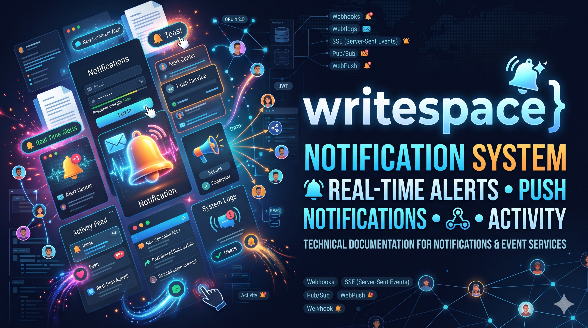
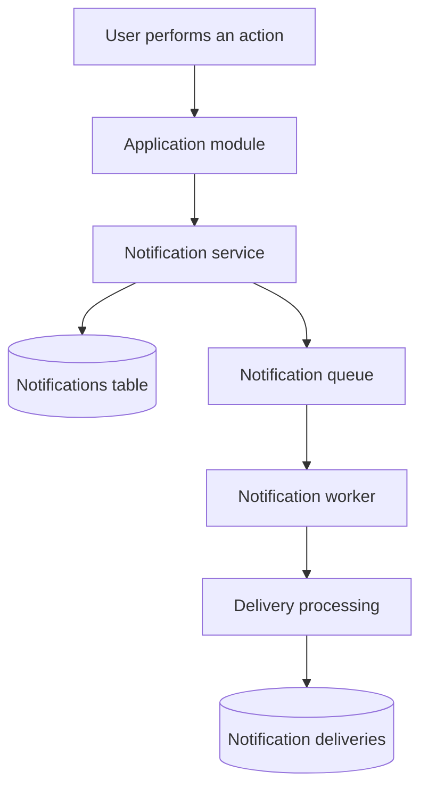
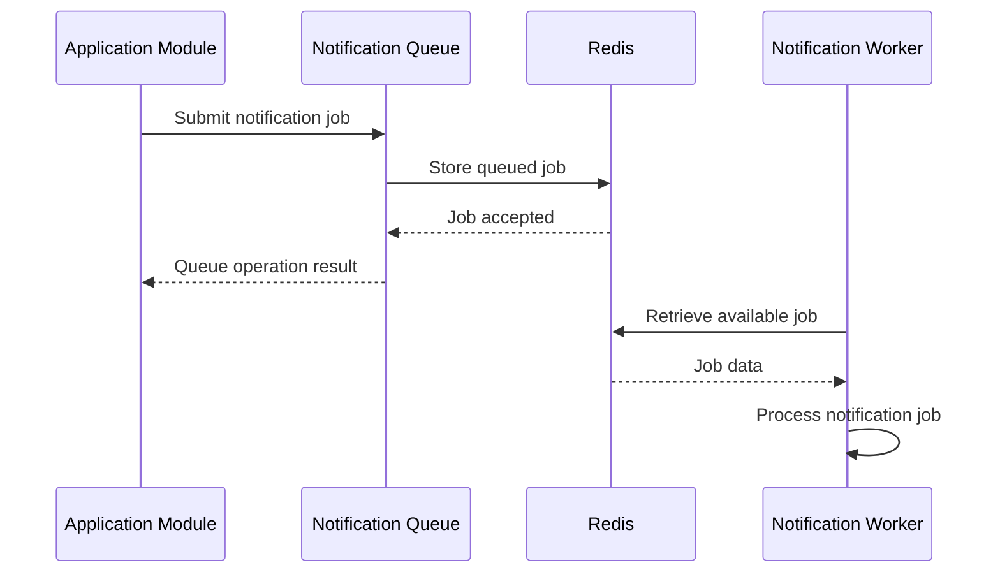
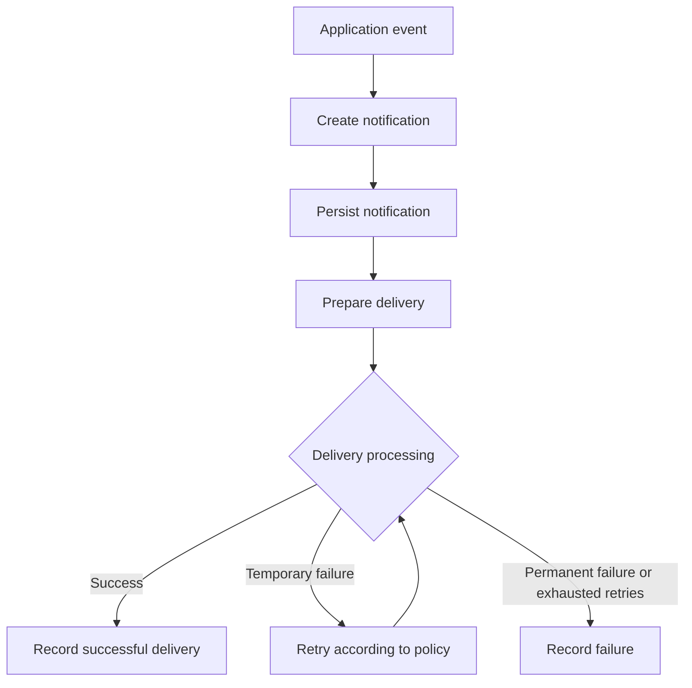

# Notifications

## Purpose

This document explains how the notification system is organized in the Writespace backend.

Notifications are an important part of a social platform because they allow users to stay informed about activity related to their accounts and content.

Examples include:

- Someone reacts to a user's content.
- Someone comments on a Post or Article.
- Someone replies to an existing comment.
- Someone follows another user.
- An account-related event requires the user's attention.

The notification system separates notification records from their delivery processing. This allows the application to create and manage notifications independently from the mechanisms responsible for delivering them.

## 1. Notification architecture overview

The notification functionality is organized around three primary responsibilities:

1. **Notification creation:** Creating a notification when an application event requires user attention.
2. **Notification persistence:** Storing notification information in the database.
3. **Notification processing:** Handling notification-related background work through queues and workers.

The relevant implementation is distributed across:

```text
src/
│
├── modules/
│   └── notification/
│       └── notification.service.ts
│
├── db/
│   └── schema/
│       ├── notifications.ts
│       └── notification-deliveries.ts
│
└── shared/
    └── queues/
        ├── notification.queue.ts
        └── notification.worker.ts
```

The notification service handles application-level notification operations, while the shared queue infrastructure handles background processing.

## 2. Notification request flow

A notification generally originates from an application event.

For example, when one user comments on another user's Article, the application may need to create a notification for the Article author.

The conceptual flow is:



This diagram describes the responsibilities at a high level. The precise ordering, transaction boundaries, and queue producer integration depend on the individual notification use case.

The important architectural distinction is that creating a notification and processing its delivery are separate responsibilities.

## 3. Notifications table

Notification records are stored in:

```text
src/db/schema/notifications.ts
```

The `notifications` table represents the notification itself.

It is responsible for storing the information required to identify:

- The user receiving the notification.
- The event or activity associated with the notification.
- The relevant entity or content reference.
- The notification's descriptive information.
- Its creation and lifecycle-related metadata.

The current schema uses a generic content entity type, including `CONTENT_ITEM`, so notification references are not restricted to the old Post-specific model.

This is important because Posts and Articles now share a common identity through `content_items`.

### Generic content references

Consider a user receiving a notification because someone commented on an Article.

The notification should be associated with the shared content identity rather than depending on an Article-specific interaction implementation.

Conceptually:

```text
Notification
     |
     v
Entity type: CONTENT_ITEM
     |
     v
Entity ID: content_item_id
     |
     v
content_items
     |
     +----> posts
     |
     +----> articles
```

This approach allows notification references to remain consistent across supported content types.

The notification entity reference identifies the related object; it should not be treated as a replacement for the underlying content or interaction record.

## 4. Notification deliveries

Delivery-related records are maintained separately in:

```text
src/db/schema/notification-deliveries.ts
```

The separation between notifications and notification deliveries is an important architectural decision.

A notification represents the event or information that should be made available to a user.

A delivery represents the processing or delivery of that notification through a delivery mechanism.

For example, the same notification might eventually be delivered through multiple channels.

Conceptually:

```text
                  Notification
                       |
           +-----------+-----------+
           |           |           |
           v           v           v
        In-app       Email       Push
       delivery     delivery    delivery
```

The diagram illustrates a possible multi-channel model. The channels actually supported by the current implementation must be determined from the delivery service and worker code.

### Why keep deliveries separate?

Separating notification records from delivery records offers several benefits:

- Notification creation is independent of individual delivery mechanisms.
- Delivery processing can be handled asynchronously.
- Delivery-specific status can be tracked separately.
- Failed delivery attempts can be investigated independently.
- Additional delivery channels can be introduced without redesigning the notification entity itself.

This separation also provides a foundation for improving delivery reliability as the platform evolves.

## 5. Notification service

The main notification service is located at:

```text
src/modules/notification/notification.service.ts
```

The service contains the application-level notification operations.

Its responsibility is to coordinate notification-related business logic rather than directly coupling every application module to delivery infrastructure.

A typical notification operation involves:

1. Receiving notification-related information.
2. Identifying the intended recipient.
3. Preparing the notification data.
4. Creating or coordinating the notification record.
5. Initiating the relevant downstream processing where configured.

Other modules should interact with the notification service through its exposed operations instead of directly manipulating notification persistence from unrelated controllers.

The service should also be careful about duplicate notifications. Retried background jobs or repeated application events must not unintentionally produce duplicate user-facing notifications.

## 6. Notification queue

The notification queue is located at:

```text
src/shared/queues/notification.queue.ts
```

The queue provides an asynchronous processing boundary for notification-related work.

Instead of performing every operation inside the original HTTP request, the application can submit suitable work for background execution.

The general flow is:



The queue and worker are backed by BullMQ and Redis through the shared queue infrastructure.

### Why use a queue?

Some notification operations should not increase the response time of an API request unnecessarily.

Background processing provides a way to move suitable work outside the synchronous request lifecycle.

It also creates a place to manage job execution independently from application controllers.

## 7. Notification worker

The notification worker is located at:

```text
src/shared/queues/notification.worker.ts
```

The worker is responsible for consuming and processing notification jobs submitted to the notification queue.

The worker provides a separate execution context for background tasks.

Its responsibilities can include:

- Reading queued notification jobs.
- Validating job data.
- Executing the corresponding notification processing logic.
- Coordinating delivery operations.
- Handling processing failures through the configured queue behavior.
- Logging relevant job execution information.

The worker should not become another application controller. Its responsibility is background execution rather than handling incoming HTTP requests.

### Queue and worker separation

The queue producer and worker have different responsibilities.

| Component            | Responsibility                                     |
| -------------------- | -------------------------------------------------- |
| Notification service | Coordinates application notification operations.   |
| Notification queue   | Accepts and schedules background jobs.             |
| Redis                | Stores and coordinates queued jobs through BullMQ. |
| Notification worker  | Executes background notification processing.       |
| Delivery layer       | Handles the relevant delivery operation.           |

This separation makes it easier to reason about notification processing and troubleshoot failures.

## 8. Failure handling and reliability

Background jobs introduce failure scenarios that need to be considered separately from normal HTTP requests.

For example:

- Redis becomes temporarily unavailable.
- A worker crashes during processing.
- A delivery provider becomes unavailable.
- A job contains invalid data.
- A job is executed more than once.
- A delivery attempt fails after the notification record has already been created.

A robust notification system must account for these situations.

### Retry behavior

When a job fails temporarily, a retry may allow it to complete later.

However, retrying a job does not guarantee that the operation is executed exactly once.

For example, a worker could successfully send an email but crash before acknowledging job completion. When the job is retried, the email might be sent again.

This is why retry behavior and idempotency must be designed together.

### Idempotency

Idempotency means that executing the same logical operation more than once does not produce unintended duplicate effects.

For notification processing, this can involve:

- Stable notification identifiers.
- Unique delivery references.
- Checking whether a delivery has already succeeded.
- Recording delivery attempts.
- Preventing duplicate side effects during retries.

Database constraints and application-level checks should work together to protect against duplicates.

### Failure visibility

The system should make it possible to identify:

- Jobs waiting for processing.
- Jobs currently being processed.
- Successfully completed jobs.
- Failed jobs.
- Delivery attempts and their outcomes.

Logging and monitoring are especially important once notification processing runs independently of the API server.

The exact retry configuration, dead-letter handling, and delivery-state transitions should be documented from the current BullMQ and worker implementation rather than assumed from the existence of a queue.

## 9. Notification lifecycle

A notification has two related but distinct lifecycles:

**Notification lifecycle**

This concerns the creation and management of the notification record.

**Delivery lifecycle**

This concerns how the notification is processed and delivered.

A simplified conceptual representation is:



This is a target-level explanation of the processing responsibilities. Actual delivery states and retry transitions must match the implementation.

A notification can exist even when a particular delivery attempt fails. This is one of the reasons the two records should remain separate.

## 10. Integration with other modules

Notifications can be triggered by activity from multiple parts of Writespace.

Examples include:

| Source module | Example activity          | Possible notification         |
| ------------- | ------------------------- | ----------------------------- |
| Interactions  | User reacts to content    | Content reaction notification |
| Interactions  | User comments on content  | New comment notification      |
| Interactions  | User replies to a comment | New reply notification        |
| Interactions  | User follows another user | New follower notification     |
| Auth          | Account security event    | Security-related notification |
| Users         | Account-related activity  | Account notification          |

These are examples of potential notification use cases. A source event does not automatically imply that every listed notification type is currently implemented.

Notification generation should respect user permissions, notification preferences, privacy rules, and relevant product requirements.

## 11. Notification security

Notifications can contain personal or activity-related information, so they need appropriate security controls.

Important considerations include:

**Recipient validation**

A notification must only be associated with the intended recipient.

**Content visibility**

A notification must not reveal information about content the recipient is not authorized to access.

**Sensitive information**

Passwords, OTP values, authentication tokens, and other sensitive credentials must never be included in ordinary notifications or job logs.

**Queue payloads**

Queue payloads should contain only the information necessary to process the job. Avoid putting unnecessary personal or sensitive information into Redis-backed job data.

**Authorization**

Retrieving notifications must be scoped to the authenticated user. A user must not be able to retrieve another user's notification records by changing an identifier.

**Delivery security**

External delivery providers and their credentials must be configured through secure environment variables or approved secret-management mechanisms.

## 12. Scaling considerations

The notification architecture separates application activity from background processing, which provides a useful foundation for scaling.

As notification volume grows, the following areas become important.

### Worker concurrency

Multiple workers can process independent jobs in parallel.

Concurrency should be configured with consideration for:

- Redis capacity.
- Database connection limits.
- External provider rate limits.
- Job processing time.
- Resource consumption.

### Queue separation

As workloads increase, different delivery responsibilities may benefit from independent queues.

For example, email delivery and in-app notification processing may have different performance and retry requirements.

This should be introduced based on actual workload characteristics rather than creating separate queues without a clear need.

### Delivery observability

Useful metrics include:

- Number of queued jobs.
- Job processing duration.
- Job failure rate.
- Retry count.
- Successful delivery count.
- Provider response failures.
- Oldest pending job age.

These metrics help identify whether the notification infrastructure is keeping up with platform activity.

## 13. Testing considerations

Notification functionality should be tested at both the application and background-processing levels.

Important scenarios include:

### Notification service

- Successful notification creation.
- Correct notification recipient.
- Correct content reference.
- Invalid recipient handling.
- Duplicate notification prevention.

### Queue and worker

- Successful job submission.
- Valid job processing.
- Invalid payload handling.
- Temporary processing failure.
- Retry behavior.
- Worker shutdown and restart behavior.
- Duplicate execution handling.

### Delivery

- Successful delivery.
- Provider failure.
- Delivery status updates.
- Duplicate delivery prevention.
- Appropriate logging of failures.

### Authorization

- Users can only access their own notifications.
- Notification references respect content visibility.
- Sensitive information is not included in notification payloads.

## 14. Future considerations

The current notification infrastructure provides the foundation for further development.

As the platform evolves, the following areas can be considered:

- In-app notification inbox.
- Real-time notification updates.
- Transactional email notifications.
- Browser push notifications.
- Native mobile push notifications.
- Notification preferences.
- Email digests.
- Per-channel delivery tracking.
- Improved retry and failure management.
- Notification aggregation for high-volume activity.

These are potential extensions and should not be treated as existing features unless they are implemented in the corresponding modules.

## Related documentation

- [Architecture Overview](../architecture/overview.md)
- [Database Schema](../database/schema.md)
- [Interactions](interactions.md)
- [Authentication and Users](authentication-and-users.md)
- [Background Jobs](../operations/background-jobs.md)
- [Local Development](../operations/local-development.md)
