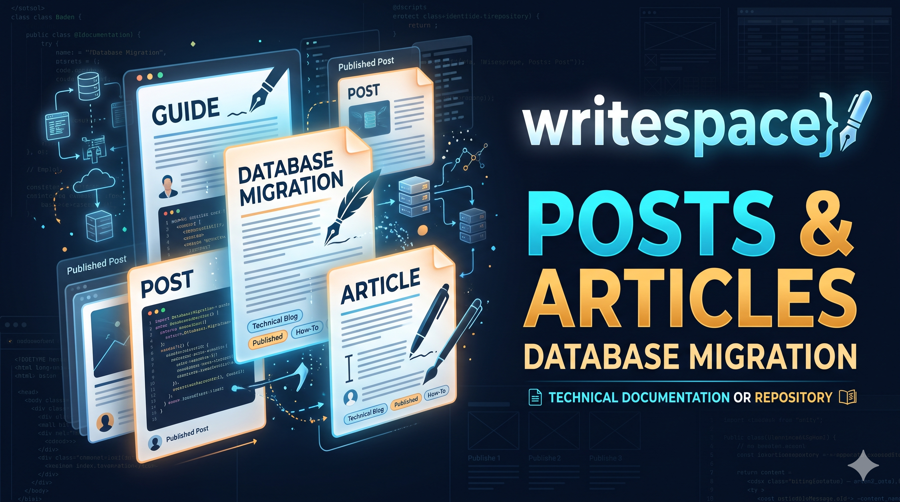
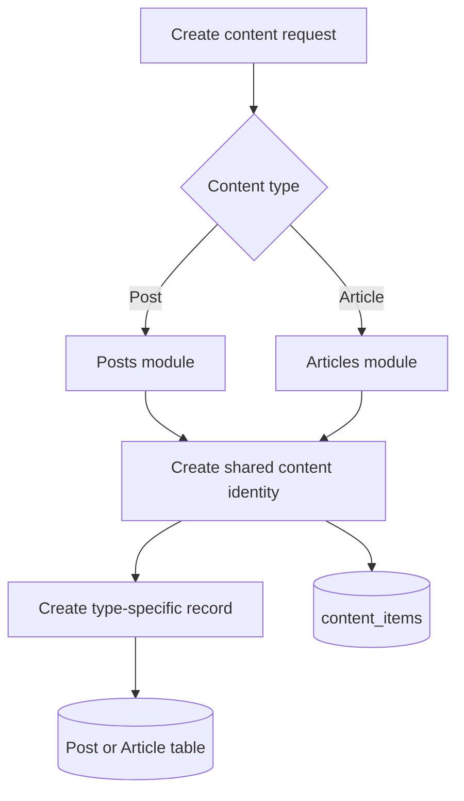
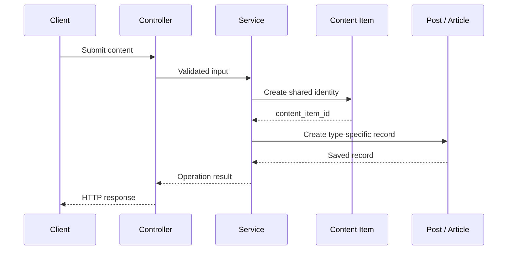
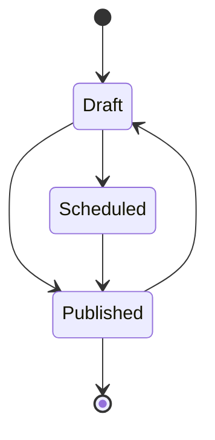

# Posts and Articles

## Purpose

This document explains how Posts and Articles are structured and managed in the Writespace backend.

Both are content types supported by the platform. They share a common content identity through the `content_items` table, but their content structures, validation rules, domain logic, and module responsibilities remain separate.

The objective of this separation is to reuse common platform capabilities without forcing different content types to follow identical business rules.

## 1. Module overview

Writespace maintains two separate modules:

```text
src/modules/
│
├── posts/
│   ├── domain/
│   ├── dtos/
│   ├── interfaces/
│   ├── services/
│   ├── posts.controller.ts
│   ├── posts.routes.ts
│   └── posts.service.ts
│
└── articles/
    ├── domain/
    ├── dtos/
    ├── interfaces/
    ├── services/
    ├── articles.controller.ts
    ├── articles.routes.ts
    └── articles.service.ts
```

Both modules follow a similar architectural pattern:

- Domain logic handles content-specific rules.
- DTOs validate incoming request data.
- Interfaces describe module-level data contracts.
- Command services handle write operations.
- Query services handle read operations.
- Media services handle content-related media operations.
- Preview services generate metadata for content previews.
- Controllers expose module operations through HTTP.
- The main service coordinates the module's use cases.

The modules share architectural conventions while retaining independent implementations.

## 2. Shared content identity

Posts and Articles use `content_items` as their common identity layer.

When a new piece of content is created, the shared content record provides the identifier that other parts of the application can use.

The type-specific record stores the actual content data.

Conceptually:



The shared record contains information such as:

- Content type
- Author
- Lifecycle status
- Scheduled publication time
- Publication date
- View count
- Reaction count
- Comment count
- Share count
- Version
- Creation and update timestamps

The Post and Article modules remain responsible for their own type-specific data.

This separation means the interaction system does not need to understand the entire Post or Article schema to identify the content being interacted with.

## 3. Posts module

The Posts module manages Post-specific content operations.

Its implementation is organized into domain logic, DTOs, interfaces, and dedicated services.

### 3.1 Domain logic

Located in:

```text
src/modules/posts/domain/
```

**`post-content.ts`**

Contains Post content-related domain logic. This helps keep content rules separate from HTTP handling and database orchestration.

**`post-lifecycle.ts`**

Contains Post lifecycle-related rules, including the behavior associated with content states and publication operations.

These rules help the module distinguish between editing content and changing its publication state.

### 3.2 Data transfer objects

Located in:

```text
src/modules/posts/dtos/
```

The current module includes:

| File                 | Responsibility                 |
| -------------------- | ------------------------------ |
| `create-post.dto.ts` | Validates Post creation input. |
| `update-post.dto.ts` | Validates Post update input.   |

DTOs help ensure that incoming requests satisfy the expected input structure before reaching the business logic.

### 3.3 Dedicated services

Located in:

```text
src/modules/posts/services/
```

**`post-command.service.ts`**

Responsible for Post write operations and coordinating the operations required to create or update Post data.

**`post-query.service.ts`**

Responsible for retrieving Post data and handling Post-specific query operations.

**`post-media.service.ts`**

Handles Post media operations. The media records are stored in `post_media`, while the associated media objects are managed through the application's media infrastructure.

The separation keeps media-specific operations outside the main Post orchestration service.

**`post-preview.service.ts`**

Handles the metadata needed when a Post is shared or previewed by external platforms.

This service is particularly relevant for social sharing, where crawlers may request metadata without executing the application's frontend.

### 3.4 Post service orchestration

The main service:

```text
src/modules/posts/posts.service.ts
```

Coordinates the operations exposed by the Posts module.

Instead of containing every implementation detail, it delegates work to the domain helpers and dedicated services.

The HTTP controller communicates with this service rather than directly accessing database repositories.

## 4. Articles module

The Articles module follows the same general architectural principles but maintains Article-specific logic.

Articles are intended for structured, longer-form content rather than simply being another variation of a Post.

### 4.1 Domain logic

Located in:

```text
src/modules/articles/domain/
```

| File                   | Responsibility                                   |
| ---------------------- | ------------------------------------------------ |
| `article-content.ts`   | Article-specific content rules and processing.   |
| `article-lifecycle.ts` | Article lifecycle and publication-related rules. |
| `article-slug.ts`      | Article slug generation and related rules.       |

The slug helper is particularly important because Article URLs need a stable, readable identifier.

The database also enforces uniqueness for Article slugs.

### 4.2 Data transfer objects

Located in:

```text
src/modules/articles/dtos/
```

| File                    | Responsibility                    |
| ----------------------- | --------------------------------- |
| `create-article.dto.ts` | Validates Article creation input. |
| `update-article.dto.ts` | Validates Article update input.   |

The Article DTOs remain independent from Post DTOs because the two content types have different fields and validation requirements.

### 4.3 Article data structure

The current Article schema includes the following information:

| Field                   | Responsibility                                       |
| ----------------------- | ---------------------------------------------------- |
| `content_item_id`       | Shared content identity and Article record identity. |
| `title`                 | Article title.                                       |
| `slug`                  | Unique URL-friendly identifier.                      |
| `subtitle`              | Optional supporting title.                           |
| `content_document`      | Structured Article content.                          |
| `excerpt`               | Short Article description.                           |
| `tags`                  | Article-associated tags.                             |
| `read_time`             | Estimated reading time.                              |
| `cover_image_url`       | Cover image location.                                |
| `cover_image_public_id` | Media storage reference.                             |
| `cover_image_alt_text`  | Alternative text for the cover image.                |
| `cover_image_credit`    | Cover image attribution.                             |

The `content_document` field uses a structured JSON document instead of requiring the Article body to be represented as a single plain text field.

The document structure is defined through the shared content document schema helper.

### 4.4 Dedicated services

Located in:

```text
src/modules/articles/services/
```

**`article-command.service.ts`**

Coordinates Article creation and update operations.

**`article-query.service.ts`**

Handles Article retrieval and query operations.

**`article-media.service.ts`**

Handles Article cover media operations and associated media metadata.

**`article-preview.service.ts`**

Provides Article preview metadata for sharing and external crawlers.

### 4.5 Article service orchestration

The main service:

```text
src/modules/articles/articles.service.ts
```

Coordinates Article-specific operations and delegates the detailed work to the dedicated services.

Article-specific behavior remains within this module rather than being added to the Posts service.

## 5. Content creation and persistence

Both content types need a shared content identity before common platform features can reference them.

The conceptual persistence flow is:



The diagram illustrates the intended creation responsibilities, not the exact SQL statement order or transaction boundaries of every implementation path.

Where multiple database writes form one logical operation, the implementation must preserve consistency so that a partially created content item is not left behind if its subtype creation fails.

The exact transactional behavior should be verified in the corresponding command service and repository implementation.

## 6. Content lifecycle

The shared content model supports three lifecycle states:

| Status      | Description                                         |
| ----------- | --------------------------------------------------- |
| `draft`     | Content is being prepared and is not published.     |
| `scheduled` | Content is scheduled for a future publication time. |
| `published` | Content has been published.                         |

Both modules use these shared lifecycle values, but the domain rules remain content-type-specific.

For example, Article validation may need to consider the structured document and Article metadata, while Post validation focuses on Post content requirements.

A simplified conceptual lifecycle is:



This diagram is illustrative rather than a complete transition specification. The actual permitted transitions and authorization rules are defined by the respective lifecycle implementations and service methods.

A scheduled item also requires the application to process its scheduled publication at the appropriate time. The lifecycle status alone does not perform that scheduling work.

## 7. Media management

Media responsibilities are separated from content command and query responsibilities.

### Post media

Posts use the `post_media` table to store media references and ordering information.

Each record includes:

- Post reference
- Media URL
- Optional public storage ID
- Position
- Optional alternative text
- Creation timestamp

The media service coordinates the Post-specific media operations.

### Article media

Articles currently store their cover media metadata directly in the Article record.

This includes:

- Cover image URL
- Storage public ID
- Alternative text
- Credit or attribution

The Article media service handles Article-specific media operations.

### Why are the media models different?

A Post may contain multiple ordered media attachments, while an Article currently has a dedicated cover image representation.

Keeping the models independent avoids introducing unnecessary complexity into the shared content identity.

The underlying storage integration can still be reused without forcing both content types to have identical database structures.

## 8. Preview metadata

Both Posts and Articles have dedicated preview services.

Their purpose is to prepare metadata that external platforms and social crawlers can use when content is shared.

A typical preview may include:

- Page title
- Description or excerpt
- Canonical URL
- Preview image
- Open Graph metadata
- Social sharing metadata

The services remain separate because Posts and Articles can derive their metadata from different content fields.

For example:

- A Post preview can use Post content and its associated media.
- An Article preview can use its title, excerpt, and cover image.

The preview service is not a replacement for the application's normal content query or authorization flow. Public preview behavior must be handled deliberately so that unpublished or restricted content is not exposed to external crawlers.

## 9. Integration with the interaction system

Both Posts and Articles participate in the shared interaction architecture.

They use their common `content_item_id` for operations such as:

| Capability | Database representation |
| ---------- | ----------------------- |
| Reactions  | `content_reactions`     |
| Saves      | `content_saves`         |
| Shares     | `content_shares`        |
| Comments   | `comments`              |
| Mentions   | `content_mentions`      |

The interaction module handles these common operations.

This means the Posts and Articles modules do not need separate implementations of the same reaction, save, share, or comment persistence logic.

For example, when a user reacts to an Article, the interaction system works with its shared content identity rather than requiring an Article-specific reaction table.

The content module remains responsible for validating its own content-specific operations, while the interaction layer handles the common interaction behavior.

## 10. Architectural responsibilities

The separation between the two content modules and the shared interaction module can be summarized as follows:

| Responsibility                 | Owner                                            |
| ------------------------------ | ------------------------------------------------ |
| Post-specific validation       | Posts module                                     |
| Article-specific validation    | Articles module                                  |
| Post lifecycle rules           | Posts module                                     |
| Article lifecycle rules        | Articles module                                  |
| Article slug generation        | Articles module                                  |
| Post media management          | Posts module                                     |
| Article cover media management | Articles module                                  |
| Post preview metadata          | Posts module                                     |
| Article preview metadata       | Articles module                                  |
| Shared content identity        | Content schema                                   |
| Reactions                      | Interactions module                              |
| Saves                          | Interactions module                              |
| Shares                         | Interactions module                              |
| Comments                       | Interactions module                              |
| Common content counters        | Shared content record and interaction operations |

This structure keeps domain boundaries clear while allowing shared platform behavior to evolve independently.

## 11. Adding future content types

The shared content identity provides a foundation for additional content types.

For example, the platform might eventually support another type such as a question, poll, or documentation entry.

A new type should not automatically inherit every Post or Article rule.

A typical extension would require:

1. Adding the new content type to the content type enum.
2. Introducing a type-specific database table.
3. Creating a dedicated module for its business rules.
4. Implementing its DTOs, interfaces, and services.
5. Registering the corresponding schema and relationships.
6. Connecting it to generic interactions where those capabilities make sense.
7. Adding tests for content identity, lifecycle, permissions, and interactions.

The objective is to reuse shared infrastructure while allowing each content type to evolve according to its own requirements.

## 12. Important implementation considerations

When modifying either content module, consider these points:

- Keep the shared content identity synchronized with the type-specific record.
- Ensure the `content_type` discriminator matches the associated subtype.
- Apply lifecycle and authorization rules before allowing changes.
- Avoid duplicating common interaction operations.
- Keep media cleanup consistent with the underlying storage system.
- Protect counter updates against concurrent modifications.
- Ensure preview endpoints do not expose unpublished content.
- Use database transactions where a logical operation involves multiple writes.
- Keep Article slug uniqueness enforced.
- Add tests for failure cases, not only successful creation and retrieval.

## Related documentation

- [Architecture Overview](../architecture/overview.md)
- [Content Model](../architecture/content-model.md)
- [Database Schema](../database/schema.md)
- [Interactions](interactions.md)
- [Authentication and Users](authentication-and-users.md)
