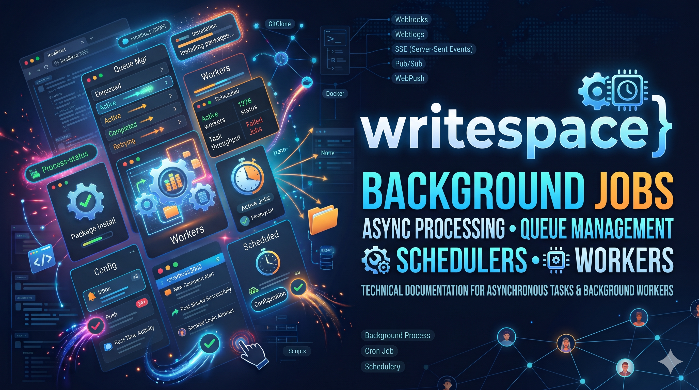
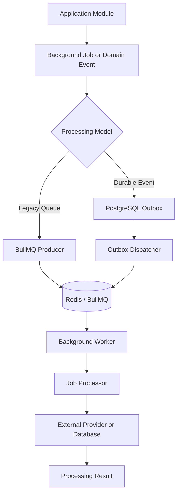
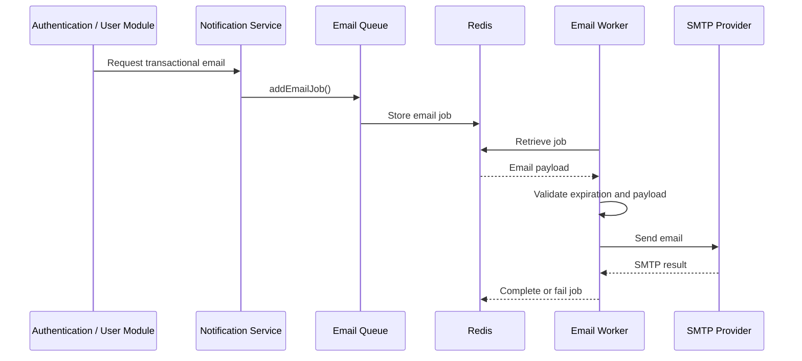
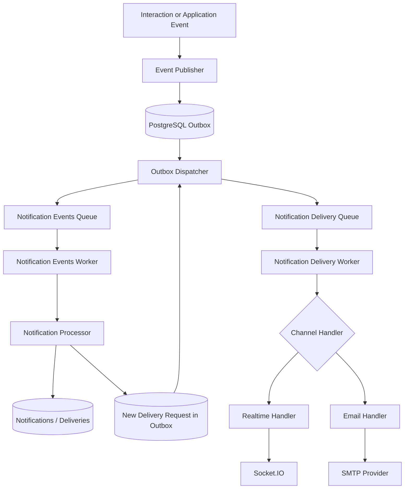
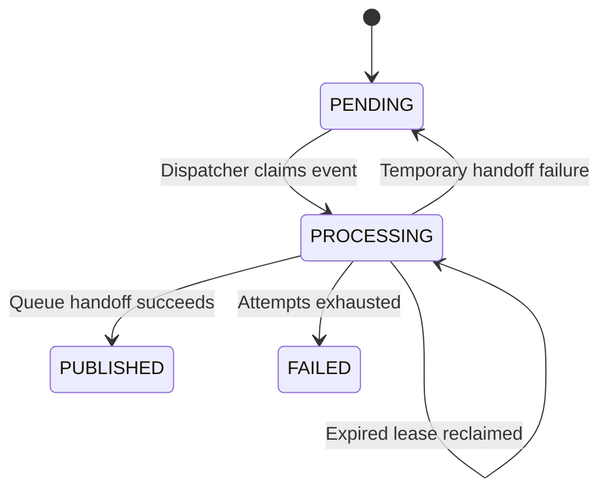
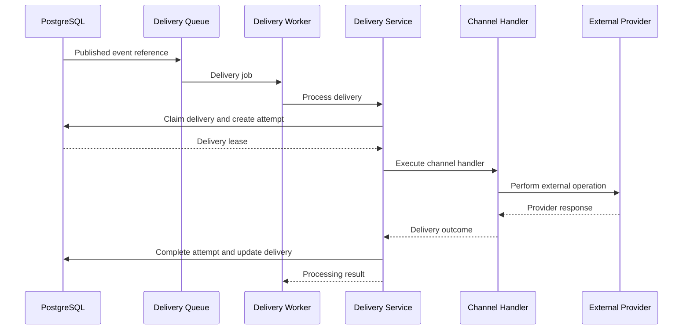

# Background Jobs

## Purpose

This document explains how background processing is organized in the Writespace backend.

Not every operation needs to be completed during an HTTP request. Some operations can be moved to background workers so that the application can respond without waiting for every downstream task.

Writespace uses BullMQ with Redis for asynchronous job processing and PostgreSQL for persistent application state.

The background processing infrastructure currently includes:

- Transactional email processing.
- Media processing.
- Notification domain-event processing.
- Notification channel delivery.
- Outbox event dispatching.
- Notification delivery reconciliation.

This document explains the responsibilities of these components, their interaction, failure handling, recovery procedures and operational considerations.

---

## 1. Background processing architecture

Background processing separates job creation from job execution.

An application module or service submits work through an appropriate producer or persists an event for asynchronous processing. BullMQ manages queue execution, while Redis provides the queue infrastructure.

PostgreSQL remains responsible for persistent application records and durable notification-processing state.

### General architecture



The two processing models have different durability characteristics.

**Legacy queue processing**

The application submits a job directly to BullMQ. Redis stores the job and the worker executes it.

This is currently used by transactional authentication emails and media-related background operations.

**Durable event processing**

The application persists an event in PostgreSQL. The outbox dispatcher later publishes a reference to that event into BullMQ.

The database remains the source of truth for the event and its processing state.

The notification system uses this durable architecture.

### Responsibilities

| Component             | Responsibility                                                  |
| --------------------- | --------------------------------------------------------------- |
| Application module    | Decides when background work is required.                       |
| Event publisher       | Persists durable application events.                            |
| PostgreSQL outbox     | Stores durable events awaiting dispatch.                        |
| Outbox dispatcher     | Publishes eligible outbox events to BullMQ.                     |
| BullMQ                | Manages scheduling, job states and worker coordination.         |
| Redis                 | Provides queue storage and coordination.                        |
| Worker                | Retrieves and executes jobs.                                    |
| Processor or handler  | Performs the actual operation.                                  |
| Reconciliation worker | Identifies and repairs eligible delivery-queue inconsistencies. |

---

## 2. Why use background jobs?

Consider a user registering on Writespace.

The application may need to:

1. Validate registration information.
2. Create the user account.
3. Prepare a welcome email.
4. Send the email through an external provider.
5. Handle the delivery result.

Sending an email depends on an external service and may introduce unpredictable latency.

Executing every operation synchronously can increase API response time and make the request dependent on external provider availability.

Instead, suitable work can be submitted to a background queue.

The API can complete its primary operation while a worker handles the email independently.

Background processing is particularly useful for operations involving:

- External APIs.
- Email providers.
- Media processing.
- Notification delivery.
- Operations that can be retried.
- Tasks that do not need to block an API response.

---

## 3. BullMQ and Redis

Writespace uses BullMQ for queue management and Redis as its underlying queue infrastructure.

### BullMQ

BullMQ provides the application-level queue and worker abstractions.

It handles responsibilities such as:

- Adding jobs to queues.
- Making jobs available to workers.
- Managing job states.
- Coordinating job execution.
- Supporting retries and delayed jobs.
- Handling concurrency.
- Managing job completion and failure.

### Redis

Redis provides the storage and coordination infrastructure required by BullMQ.

The application uses Redis for background job processing rather than as its primary relational database.

PostgreSQL remains responsible for persistent application and notification delivery records.

### Infrastructure configuration

The shared BullMQ configuration is maintained in:

```text
src/config/bullmq.ts
```

Redis connectivity is managed through the application's shared Redis configuration.

Queue and worker definitions should reuse the appropriate shared configuration rather than introducing unrelated Redis connections throughout the application.

---

## 4. Queue and worker organization

The existing queue infrastructure is distributed across shared queues and module-specific notification workers.

### Shared queues

```text
src/shared/queues/

├── email.queue.ts
├── email.worker.ts
│
├── media.queue.ts
├── media.worker.ts
│
├── notification-events.queue.ts
└── notification-delivery-events.queue.ts
```

The notification-specific consumers and dispatcher are located in:

```text
src/modules/notification/workers/

├── notification-events.worker.ts
├── notification-delivery-events.worker.ts
├── outbox-dispatcher.worker.ts
└── notification-reconciliation.worker.ts
```

The notification processing services are located in:

```text
src/modules/notification/services/

├── event-publisher.service.ts
├── notification-processor.service.ts
├── notification-delivery.service.ts
├── outbox-dispatcher.service.ts
└── notification-reconciliation.service.ts
```

The repository layer maintains persistent processing state.

```text
src/modules/notification/repositories/

├── outbox.repository.ts
├── processed-event.repository.ts
├── notification-delivery.repository.ts
└── notification-reconciliation.repository.ts
```

Queue producers and workers have separate responsibilities.

A producer submits work, while a worker retrieves and processes it.

---

## 5. Transactional email processing

Transactional authentication and account-related email operations are handled through the legacy email queue.

Implementation:

```text
src/modules/notification/notification.service.ts

src/shared/queues/email.queue.ts
src/shared/queues/email.worker.ts

src/shared/infra/mailer.ts
```

The notification service retains a legacy email facade for existing authentication and user flows.

Supported email operations include:

- Welcome emails.
- Account verification OTP emails.
- Password reset emails.
- Login alerts.
- Password update confirmations.
- Profile update notifications.

### Email processing flow



### Email queue configuration

The generic email queue uses:

| Configuration              |  Default |
| -------------------------- | -------: |
| `EMAIL_WORKER_CONCURRENCY` |        5 |
| `EMAIL_QUEUE_ATTEMPTS`     |        3 |
| `QUEUE_BACKOFF_DELAY_MS`   | 1,000 ms |

Retries use exponential backoff.

Successfully completed jobs are removed.

Ordinary permanently failed jobs use bounded retention:

- 24 hours.
- Maximum 5,000 retained failed jobs.

Password-reset and OTP jobs use stricter failed-job retention because their payloads contain sensitive credentials or short-lived codes.

### OTP expiration

The existing email worker skips OTP email jobs older than ten minutes.

This prevents stale verification codes from being delivered after their intended validity period.

The current implementation calculates the age using the BullMQ job creation timestamp.

### SMTP infrastructure

Both email pipelines use the shared Nodemailer transport:

```text
src/shared/infra/mailer.ts
```

Current SMTP settings include:

| Environment variable         |   Default |
| ---------------------------- | --------: |
| `SMTP_CONNECTION_TIMEOUT_MS` | 30,000 ms |
| `SMTP_GREETING_TIMEOUT_MS`   | 15,000 ms |
| `SMTP_SOCKET_TIMEOUT_MS`     | 60,000 ms |

The socket timeout measures inactivity, not total email-send duration.

### Email failure classification

The legacy email worker distinguishes between:

- Successful SMTP recipient acceptance.
- Temporary SMTP rejection.
- Permanent SMTP rejection.
- Failures before message transmission.
- Uncertain outcomes after message transmission may have started.

BullMQ can retry temporary failures.

Permanent and uncertain failures are not blindly retried. This is particularly important for OTP and password-reset messages because the legacy queue does not have the same PostgreSQL delivery-attempt ledger as the durable notification pipeline.

---

## 6. Media processing

Media processing is handled through:

```text
src/shared/queues/media.queue.ts
src/shared/queues/media.worker.ts
```

Media operations can involve external storage providers and processing tasks that do not need to block HTTP requests.

For example, media-related work may require:

- Processing an uploaded media reference.
- Communicating with an external storage service.
- Performing a cleanup operation.
- Coordinating media-related background work.

The Posts and Articles modules retain responsibility for their content-specific media rules.

The shared media infrastructure provides a reusable place to execute suitable background tasks.

### Important considerations

Media processing needs to account for:

- Invalid media references.
- Storage provider failures.
- Missing or deleted objects.
- Duplicate processing.
- Partial processing failures.
- Cleanup of orphaned media objects.

A PostgreSQL transaction cannot automatically roll back an operation already performed against an external storage provider.

---

## 7. Durable notification event processing

Notification background processing uses a PostgreSQL outbox and two BullMQ queues.

The two queues have different responsibilities.

| Queue                              | Responsibility                                                 |
| ---------------------------------- | -------------------------------------------------------------- |
| Notification events queue          | Processes domain events that may produce notifications.        |
| Notification delivery events queue | Processes requests to deliver notifications through a channel. |

Queue definitions:

```text
src/shared/queues/

├── notification-events.queue.ts
└── notification-delivery-events.queue.ts
```

### High-level processing flow



This architecture separates the recording of application events, notification creation and external channel delivery.

### Domain event processing

Domain events are persisted through the event publisher and outbox infrastructure.

The notification events worker consumes the corresponding event references and invokes the notification processor.

The processor validates the event and evaluates the applicable notification policy.

Currently supported social notification policies include:

- `reaction.added`
- `follow.created`
- `share.created`

The exact event contracts and supported event types are maintained in the notification domain and event registry.

### Processed-event idempotency

The processed-event repository maintains consumer-level processing state.

The database uses a composite identity based on:

```text
consumer_name + event_id
```

This prevents the same consumer from creating duplicate notification side effects when an event is replayed.

A repeated event that has already been processed is recognized as a duplicate rather than creating another notification.

The processing reservation and associated database mutations are coordinated transactionally.

---

## 8. PostgreSQL transactional outbox

The outbox table is:

```text
outbox_events
```

Schema:

```text
src/db/schema/outbox-events.ts
```

The outbox stores:

- Event identity.
- Event name and version.
- Producer.
- Aggregate type and aggregate ID.
- Event payload.
- Metadata.
- Occurrence time.
- Dispatch status.
- Attempt count.
- Availability time.
- Dispatcher lease.
- Last error.
- Publication timestamp.
- Failure timestamp.

### Outbox lifecycle

The outbox currently uses these states:

| State        | Meaning                                                        |
| ------------ | -------------------------------------------------------------- |
| `PENDING`    | Waiting for dispatch.                                          |
| `PROCESSING` | Claimed by a dispatcher.                                       |
| `PUBLISHED`  | Successfully handed off to BullMQ.                             |
| `FAILED`     | Dispatch attempts exhausted and operational recovery required. |



### Outbox dispatcher

The implementation is located in:

```text
src/modules/notification/services/outbox-dispatcher.service.ts

src/modules/notification/workers/outbox-dispatcher.worker.ts
```

Its responsibilities include:

1. Finding available outbox events.
2. Claiming events with database leases.
3. Publishing the appropriate event reference to BullMQ.
4. Persisting successful publication.
5. Scheduling temporary handoff failures.
6. Moving exhausted events to `FAILED`.

The dispatcher uses PostgreSQL row locking and `SKIP LOCKED` to coordinate concurrent dispatcher instances.

### Deterministic job identifiers

Delivery-request events use:

```text
notification-delivery-event-{outbox-event-id}
```

Domain events use:

```text
notification-event-{outbox-event-id}
```

These deterministic job identifiers help prevent unnecessary duplicate queue jobs during repeated handoff attempts.

### Important distinction

`PUBLISHED` only means that the dispatcher successfully handed the event to BullMQ.

It does not guarantee that the notification worker processed the event or that the external channel accepted the delivery.

---

## 9. Notification delivery processing

Notification delivery records are stored in:

```text
notification_deliveries
```

Individual attempt history is stored in:

```text
notification_delivery_attempts
```

The schemas are:

```text
src/db/schema/notification-deliveries.ts
src/db/schema/notification-delivery-attempts.ts
```

The delivery worker is:

```text
src/modules/notification/workers/notification-delivery-events.worker.ts
```

The delivery service is:

```text
src/modules/notification/services/notification-delivery.service.ts
```

### Delivery flow



### Delivery channel handlers

The current implementation registers:

```text
src/modules/notification/handlers/

├── notification-email.handler.ts
└── notification-realtime.handler.ts
```

The handlers perform channel-specific work.

**Email handler**

- Validates the recipient.
- Loads recipient information.
- Prepares notification email content.
- Sends through the shared mailer.
- Interprets accepted and rejected recipient results.
- Classifies uncertain external outcomes conservatively.

**Realtime handler**

- Retrieves the persisted notification representation.
- Validates recipient ownership and notification lifecycle.
- Emits realtime notification events through Socket.IO.
- Emits unread-count updates.

Realtime acceptance indicates that the server accepted the emission operation. It does not prove that the browser received or displayed the event.

REST synchronization remains authoritative when clients reconnect.

### Delivery statuses

| Status             | Meaning                                           |
| ------------------ | ------------------------------------------------- |
| `queued`           | Waiting for an eligible channel attempt.          |
| `processing`       | Owned by a delivery worker.                       |
| `accepted`         | Accepted by the delivery transport.               |
| `delivered`        | Confirmed delivery where supported.               |
| `retryable_failed` | Temporary failure with another attempt scheduled. |
| `permanent_failed` | Permanent failure.                                |
| `suppressed`       | Intentionally not delivered.                      |
| `unknown`          | External outcome could not be determined safely.  |
| `dead_lettered`    | Configured attempts exhausted.                    |

An accepted email is not necessarily confirmed inbox delivery.

---

## 10. Delivery leases and heartbeat renewal

The delivery repository manages:

- Delivery claiming.
- Active attempt creation.
- Lease ownership.
- Lease renewal.
- Attempt completion.
- Expired lease resolution.

The relevant implementation is:

```text
src/modules/notification/repositories/
notification-delivery.repository.ts
```

### Why delivery leases are needed

A worker may crash or become unresponsive while performing an external operation.

Without lease ownership, another worker might start a second operation while the first is still executing.

A delivery lease prevents multiple workers from intentionally owning the same delivery concurrently.

### Heartbeat renewal

The delivery service periodically renews the active lease while the channel handler is running.

The current heartbeat interval is calculated as approximately one-third of the configured delivery lease duration.

The repository verifies:

- Delivery status.
- Worker ownership.
- Current attempt number.
- Existing lease validity.

An expired lease cannot be revived by a late heartbeat.

### Lease expiry

When a delivery worker lease expires, the delivery outcome becomes ambiguous.

The active attempt is recorded as:

```text
outcome = ambiguous
```

The delivery becomes:

```text
status = unknown
```

Automatic retry is intentionally not performed because the external email or realtime operation may already have succeeded.

### Lease configuration

```env
NOTIFICATION_DELIVERY_LEASE_DURATION_MS=60000
```

The notification delivery lease is independent from:

```env
OUTBOX_DISPATCHER_LEASE_DURATION_MS=60000
```

The two lease durations serve different responsibilities.

---

## 11. Notification delivery reconciliation

The reconciliation system repairs inconsistencies between PostgreSQL delivery records and BullMQ jobs.

Implementation:

```text
src/modules/notification/

├── repositories/
│   └── notification-reconciliation.repository.ts
│
├── services/
│   └── notification-reconciliation.service.ts
│
└── workers/
    └── notification-reconciliation.worker.ts
```

PostgreSQL remains the source of truth for delivery eligibility and state.

BullMQ is the execution mechanism.

### Why reconciliation is necessary

Consider a queue handoff that succeeds, followed by a worker failure.

The outbox event may already be marked `PUBLISHED`, while the delivery record remains `queued`.

The reconciliation worker identifies this inconsistency and attempts safe recovery.

### Reconciliation responsibilities

The reconciliation process:

1. Resolves expired delivery worker leases.
2. Expires delivery requests that have passed their useful lifetime.
3. Identifies delivery requests whose outbox event failed.
4. Claims due delivery records with a separate reconciliation lease.
5. Inspects the deterministic BullMQ job.
6. Recreates missing jobs where recovery is safe.
7. Retries retained failed jobs within a bounded recovery budget.
8. Releases reconciliation ownership.
9. Records recovery diagnostics.

### Queue recovery rules

| BullMQ state       | Action                                                     |
| ------------------ | ---------------------------------------------------------- |
| Missing            | Recreate the original job.                                 |
| `failed`           | Retry the retained job within the recovery budget.         |
| `completed`        | Reconcile against PostgreSQL and requeue when appropriate. |
| `waiting`          | Leave unchanged.                                           |
| `active`           | Leave unchanged.                                           |
| `delayed`          | Leave unchanged.                                           |
| `prioritized`      | Leave unchanged.                                           |
| `waiting-children` | Leave unchanged.                                           |
| `unknown`          | Record diagnostics; do not mutate automatically.           |

All recovered jobs reuse their original deterministic job identifiers.

### Separate recovery counters

The system separates:

- `attempt_count`: Actual channel delivery attempts.
- `reconciliation_attempt_count`: Queue-recovery operations.

Repairing a BullMQ job must not falsely increment actual email or realtime delivery attempts.

### Recovery budget

The default reconciliation recovery budget is five operations.

The relevant environment variable is:

```env
NOTIFICATION_RECONCILIATION_MAX_ATTEMPTS=5
```

Once exhausted, automatic recovery stops.

The corresponding delivery needs operational investigation.

### Failed outbox events

An outbox event marked `FAILED` is not automatically changed back to `PENDING`.

The reconciliation process flags the related delivery with:

```text
outbox_event_failed_manual_recovery_required
```

An operator must investigate the original handoff failure before deciding whether replay is safe.

### Reconciliation configuration

```env
NOTIFICATION_RECONCILIATION_INTERVAL_MS=15000
NOTIFICATION_RECONCILIATION_BATCH_SIZE=25
NOTIFICATION_RECONCILIATION_LEASE_DURATION_MS=30000
NOTIFICATION_RECONCILIATION_MAX_ATTEMPTS=5
NOTIFICATION_RECONCILIATION_INITIAL_GRACE_PERIOD_MS=30000
NOTIFICATION_RECONCILIATION_RETRY_DELAY_MS=60000
```

The values above are defaults. Deployment environment configuration may override them.

---

## 12. Graceful worker lifecycle

Workers are initialized through:

```text
src/server.ts
```

The durable notification pipeline starts only when:

```env
OUTBOX_PROCESSING_ENABLED=true
```

The server initializes the required notification queues and consumers before starting the outbox dispatcher.

This prevents the dispatcher from publishing jobs before their consumers are ready.

### Shutdown order

The application uses graceful shutdown to stop background processing and release infrastructure resources.

The current shutdown order is:

1. Outbox dispatcher.
2. Notification reconciliation worker.
3. Existing email and media workers.
4. Notification event and delivery workers.
5. BullMQ queues.
6. Redis connection.
7. PostgreSQL pool.

The reconciliation worker stops scheduling new cycles and waits for an active reconciliation cycle to finish.

Queues are closed after their corresponding workers.

### Shutdown timeout

```env
SHUTDOWN_TIMEOUT_MS=120000
```

This is the maximum configured application shutdown period before forced termination.

Graceful shutdown does not guarantee that an external operation can be cancelled after it has started. Delivery leases and ambiguous outcomes remain important safeguards.

---

## 13. Retry handling and idempotency

Retries help recover from temporary failures.

However, a retry does not guarantee exactly-once execution.

A worker may successfully perform an external operation and fail before acknowledging completion.

### Retry responsibilities

| Layer                  | Responsibility                               |
| ---------------------- | -------------------------------------------- |
| BullMQ                 | Queue-level attempts and backoff.            |
| Outbox dispatcher      | Durable event-to-queue handoff retries.      |
| Notification processor | Consumer-level event idempotency.            |
| Delivery service       | Channel attempt and retry policy.            |
| Reconciliation         | Repair eligible queue-state inconsistencies. |

### Idempotency

The processed-event repository uses a composite identity:

```text
consumer_name + event_id
```

The delivery table also has a unique idempotency key.

Stable outbox event IDs are reused when recovering queue jobs.

### Ambiguous external operations

A connection failure after message transmission may have started does not prove that SMTP rejected the message.

Automatically retrying an uncertain operation may create duplicate messages.

Therefore, ambiguous outcomes are recorded as `unknown` and require investigation rather than blind retry.

---

## 14. Environment configuration reference

| Variable                                              | Default | Responsibility                             |
| ----------------------------------------------------- | ------: | ------------------------------------------ |
| `EMAIL_WORKER_CONCURRENCY`                            |       5 | Generic email worker concurrency.          |
| `EMAIL_QUEUE_ATTEMPTS`                                |       3 | Generic email retry limit.                 |
| `NOTIFICATION_WORKER_CONCURRENCY`                     |      10 | Notification worker concurrency.           |
| `NOTIFICATION_QUEUE_ATTEMPTS`                         |       2 | Notification queue retry limit.            |
| `QUEUE_BACKOFF_DELAY_MS`                              |   1,000 | Queue exponential backoff base.            |
| `OUTBOX_PROCESSING_ENABLED`                           |   false | Enables the durable notification pipeline. |
| `OUTBOX_DISPATCHER_POLL_INTERVAL_MS`                  |   1,000 | Outbox dispatcher polling interval.        |
| `OUTBOX_DISPATCHER_BATCH_SIZE`                        |      25 | Maximum dispatcher batch size.             |
| `OUTBOX_DISPATCHER_LEASE_DURATION_MS`                 |  60,000 | Outbox dispatcher lease.                   |
| `NOTIFICATION_DELIVERY_LEASE_DURATION_MS`             |  60,000 | Channel delivery lease.                    |
| `NOTIFICATION_RECONCILIATION_INTERVAL_MS`             |  15,000 | Reconciliation polling interval.           |
| `NOTIFICATION_RECONCILIATION_BATCH_SIZE`              |      25 | Reconciliation batch size.                 |
| `NOTIFICATION_RECONCILIATION_LEASE_DURATION_MS`       |  30,000 | Reconciliation ownership lease.            |
| `NOTIFICATION_RECONCILIATION_MAX_ATTEMPTS`            |       5 | Queue-recovery budget.                     |
| `NOTIFICATION_RECONCILIATION_INITIAL_GRACE_PERIOD_MS` |  30,000 | First reconciliation grace period.         |
| `NOTIFICATION_RECONCILIATION_RETRY_DELAY_MS`          |  60,000 | Delay before another inspection.           |
| `SMTP_CONNECTION_TIMEOUT_MS`                          |  30,000 | SMTP connection timeout.                   |
| `SMTP_GREETING_TIMEOUT_MS`                            |  15,000 | SMTP greeting timeout.                     |
| `SMTP_SOCKET_TIMEOUT_MS`                              |  60,000 | SMTP socket inactivity timeout.            |
| `SHUTDOWN_TIMEOUT_MS`                                 | 120,000 | Graceful shutdown deadline.                |

All defaults are defined in:

```text
src/config/env.ts
```

---

## 15. Operational SQL queries

PostgreSQL is the source of truth for durable notification delivery state.

These queries help investigate background processing problems.

### Delivery status summary

```sql
SELECT
    status,
    COUNT(*) AS total
FROM notification_deliveries
GROUP BY status
ORDER BY status;
```

### Failed notification outbox events

```sql
SELECT
    e.id AS event_id,
    e.aggregate_id AS delivery_id,
    e.attempt_count AS outbox_attempts,
    e.last_error,
    e.failed_at,
    d.status AS delivery_status,
    d.reconciliation_last_error
FROM outbox_events e
LEFT JOIN notification_deliveries d
    ON d.id::text = e.aggregate_id
WHERE e.event_name = 'notification.delivery.requested'
  AND e.aggregate_type = 'notification_delivery'
  AND e.status = 'FAILED'
ORDER BY e.failed_at DESC NULLS LAST;
```

### Expired delivery worker leases

```sql
SELECT
    id,
    channel,
    status,
    attempt_count,
    locked_by,
    lease_expires_at,
    last_error_code
FROM notification_deliveries
WHERE status = 'processing'
  AND lease_expires_at <= clock_timestamp()
ORDER BY lease_expires_at;
```

These records should be resolved as ambiguous by reconciliation.

Do not automatically retry them.

### Deliveries requiring manual investigation

```sql
SELECT
    id,
    channel,
    status,
    attempt_count,
    reconciliation_attempt_count,
    reconciliation_last_error,
    last_error_code,
    updated_at
FROM notification_deliveries
WHERE status IN (
    'unknown',
    'permanent_failed',
    'dead_lettered'
)
ORDER BY updated_at DESC;
```

### Reconciliation recovery budget exhausted

```sql
SELECT
    id,
    channel,
    status,
    reconciliation_attempt_count,
    reconciliation_last_attempt_at,
    reconciliation_last_error,
    updated_at
FROM notification_deliveries
WHERE reconciliation_attempt_count >= 5
  AND status IN ('queued', 'retryable_failed')
ORDER BY updated_at DESC;
```

Change the value five if `NOTIFICATION_RECONCILIATION_MAX_ATTEMPTS` is configured differently.

### Individual delivery attempt history

Replace the UUID with the relevant delivery ID.

```sql
SELECT
    id,
    attempt_number,
    outcome,
    started_at,
    completed_at,
    latency_ms,
    error_code,
    provider_response_code,
    provider_message_id
FROM notification_delivery_attempts
WHERE delivery_id = 'REPLACE_WITH_DELIVERY_UUID'
ORDER BY attempt_number;
```

### Expired outbox dispatcher leases

```sql
SELECT
    id,
    event_name,
    status,
    attempt_count,
    locked_by,
    lease_expires_at,
    last_error
FROM outbox_events
WHERE status = 'PROCESSING'
  AND lease_expires_at <= clock_timestamp()
ORDER BY lease_expires_at;
```

The outbox dispatcher is responsible for reclaiming expired processing leases.

---

## 16. Monitoring and observability

Structured logs currently help identify:

- Failed email jobs.
- Failed notification event processing.
- Delivery handler errors.
- Expired delivery leases.
- Lost worker ownership.
- Recreated BullMQ jobs.
- Retried failed jobs.
- Completed-job inconsistencies.
- Exhausted reconciliation recovery budgets.
- Failed outbox handoffs.
- Worker startup and shutdown.

Useful metrics for a future monitoring integration include:

| Metric                        | Why it matters                          |
| ----------------------------- | --------------------------------------- |
| Waiting jobs                  | Indicates queued workload.              |
| Active jobs                   | Shows current processing activity.      |
| Failed jobs                   | Helps identify persistent failures.     |
| Oldest waiting job            | Helps identify backlog growth.          |
| Delivery attempt latency      | Helps identify slow providers.          |
| Unknown deliveries            | Indicates ambiguous external outcomes.  |
| Expired leases                | Identifies worker reliability problems. |
| Reconciliation recovery count | Indicates queue-state inconsistencies.  |
| Failed outbox events          | Identifies unsuccessful handoffs.       |
| Worker availability           | Confirms processing capacity.           |

No dedicated Prometheus or Grafana integration is documented as part of the current implementation.

---

## 17. Security considerations

Background processing introduces additional security considerations because job data is stored and processed independently from HTTP requests.

Important practices include:

- Keep job payloads minimal.
- Avoid storing credentials or authentication tokens in Redis.
- Apply stricter retention to jobs containing OTP values or password-reset links.
- Validate job payloads before processing.
- Restrict access to Redis.
- Protect Redis and SMTP credentials.
- Avoid logging passwords, OTPs, reset tokens or sensitive personal information.
- Validate recipient ownership.
- Treat queued payloads as untrusted input.
- Keep external provider credentials in secure environment configuration.

---

## 18. Testing and verification

The notification processing system should eventually be tested at multiple layers.

Important scenarios include:

### Queue processing

- Successful job submission.
- Invalid payload.
- Redis connection failure.
- Failed job retention.
- Queue-level retries.

### Outbox processing

- Successful queue handoff.
- Duplicate dispatch.
- Dispatcher crash.
- Expired dispatcher lease.
- Exhausted outbox attempts.

### Delivery processing

- Successful email delivery acceptance.
- Successful realtime emission.
- Temporary provider failure.
- Permanent provider failure.
- Ambiguous external result.
- Stale worker completion.
- Lease renewal failure.

### Reconciliation

- Missing BullMQ job.
- Failed retained job.
- Inconsistent completed job.
- Expired delivery lease.
- Expired reconciliation lease.
- Reconciliation recovery budget exhaustion.
- Failed outbox event requiring manual intervention.

### Lifecycle

- Worker readiness.
- Worker restart.
- Graceful shutdown.
- Shutdown during active work.

Automated testing and failure simulation should be completed before declaring the entire background notification infrastructure production-verified.

---

## Related documentation

- [Architecture Overview](../architecture/overview.md)
- [Database Schema](../database/schema.md)
- [Database Migrations](../database/migrations.md)
- [Notifications](../modules/notifications.md)
- [Interactions](../modules/interactions.md)
- [Authentication and Users](../modules/authentication-and-users.md)
- [Local Development](local-development.md)
