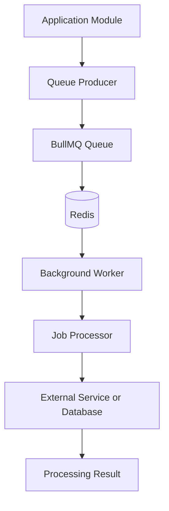
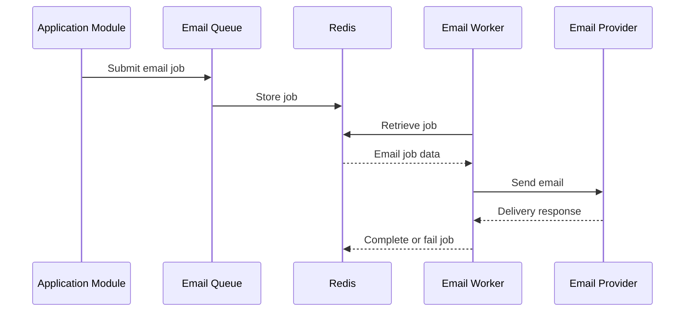
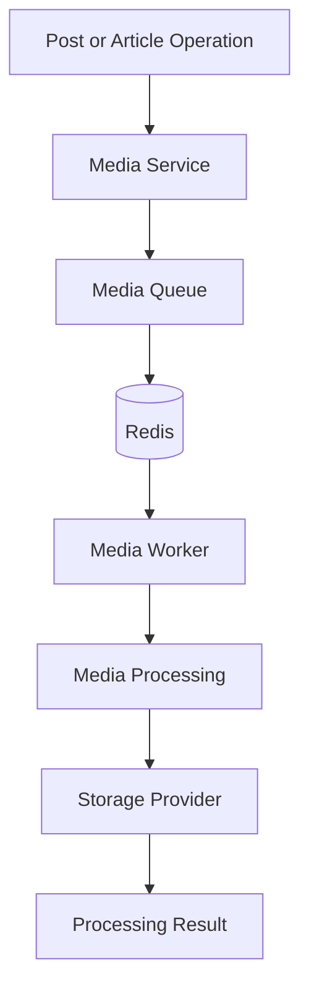
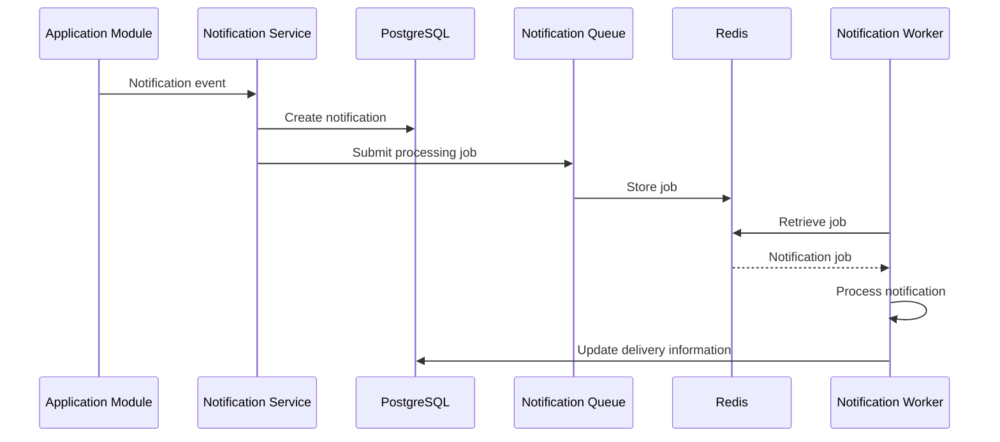
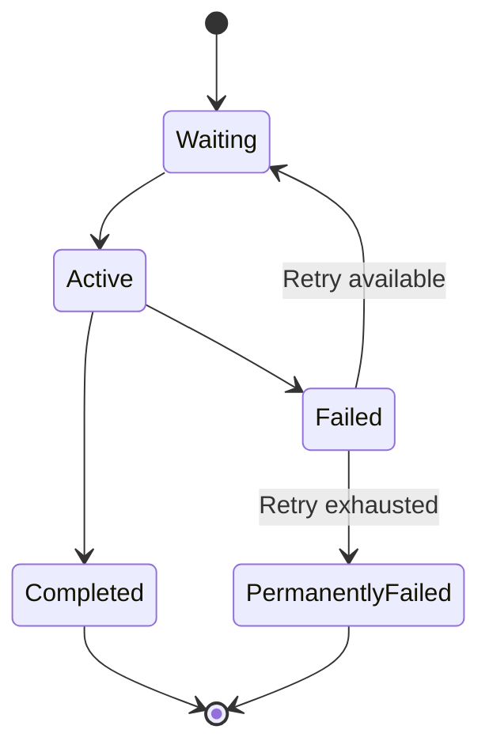
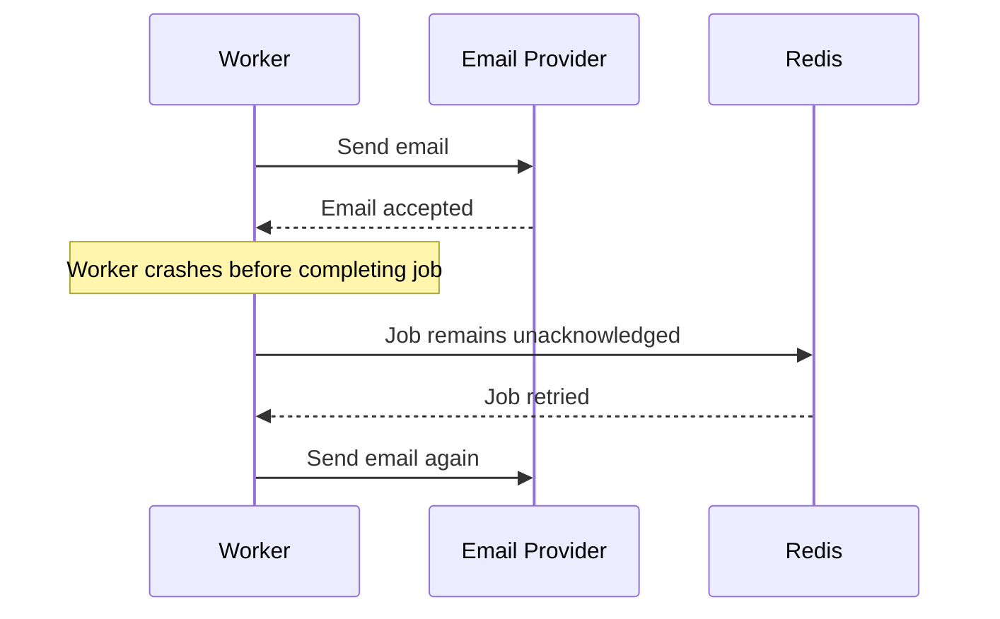

# Background Jobs

## Purpose

This document explains how background processing is organized in the Writespace backend.

Not every operation needs to be completed during an HTTP request. Some operations can be moved to background workers so that the application can respond to users without waiting for every downstream task to finish.

Writespace uses BullMQ with Redis to manage asynchronous job processing.

The background job infrastructure currently contains queues and workers for:

- Email processing
- Media processing
- Interaction processing
- Notification processing

This document explains the responsibilities of these components and how they fit into the backend architecture.

## 1. Background processing architecture

Background processing separates job creation from job execution.

A module or service can submit a job to a queue. The queue stores and manages the job through Redis, while a dedicated worker retrieves and processes it.

The general architecture looks like this:



The main components have separate responsibilities:

| Component          | Responsibility                                                   |
| ------------------ | ---------------------------------------------------------------- |
| Application module | Decides when background work is required.                        |
| Queue producer     | Creates and submits a job.                                       |
| BullMQ             | Manages job scheduling, state, and execution coordination.       |
| Redis              | Provides the underlying storage and coordination used by BullMQ. |
| Worker             | Retrieves and executes queued jobs.                              |
| Job processor      | Performs the actual operation represented by the job.            |

This separation keeps background processing independent from the HTTP request lifecycle.

## 2. Why use background jobs?

Consider a user registering on Writespace.

The application may need to perform several operations:

1. Validate registration information.
2. Create the user account.
3. Prepare a welcome email.
4. Send the email through an external provider.
5. Record or handle the delivery result.

The first operations are part of the account creation request. Sending an email, however, depends on an external service and may take additional time.

Executing everything synchronously can increase request latency and make the request dependent on external provider availability.

Instead, suitable work can be submitted to a queue.

The API can complete its primary operation while a worker handles the email independently.

Background processing is particularly useful for operations involving:

- External APIs.
- Email providers.
- Media processing.
- Notification delivery.
- Operations that can be retried.
- Tasks that do not need to block the API response.

## 3. BullMQ and Redis

Writespace uses BullMQ for queue management and Redis as its underlying queue infrastructure.

### BullMQ

BullMQ provides the application-level queue and worker abstractions.

It handles responsibilities such as:

- Adding jobs to queues.
- Making jobs available to workers.
- Managing job states.
- Coordinating job execution.
- Supporting retries and delayed jobs when configured.
- Handling concurrency and job processing.

### Redis

Redis provides the storage and coordination infrastructure required by BullMQ.

The application uses Redis for background job processing rather than using it as the primary relational database.

PostgreSQL remains responsible for persistent application records.

### Infrastructure configuration

The BullMQ configuration is maintained in:

```text
src/config/bullmq.ts
```

This is the shared configuration entry point for queue-related Redis connectivity and infrastructure settings.

Queue and worker definitions should reuse the appropriate shared configuration rather than introducing unrelated connection configurations throughout the application.

## 4. Queue and worker organization

The shared queue infrastructure is located at:

```text
src/shared/queues/
```

The current structure includes:

```text
src/shared/queues/
│
├── email.queue.ts
├── email.worker.ts
│
├── media.queue.ts
├── media.worker.ts
│
├── interaction.queue.ts
├── interaction.worker.ts
│
├── notification.queue.ts
└── notification.worker.ts
```

The queue and worker files are separated by responsibility.

A queue producer is responsible for submitting jobs, while its corresponding worker is responsible for consuming and processing them.

This keeps job submission separate from job execution.

## 5. Email processing

Email processing is handled through:

```text
src/shared/queues/email.queue.ts
src/shared/queues/email.worker.ts
```

Email operations frequently depend on external providers. Moving suitable email work into a background queue prevents the application from needing to wait for the provider during every request.

Examples of transactional email use cases include:

- Account verification.
- Password reset.
- Welcome messages.
- Security-related account notifications.

The general flow is:



The application module should prepare the information required for the email operation and submit the job.

The worker handles the actual processing and interaction with the configured email infrastructure.

### Reliability considerations

Email processing has an important failure scenario.

An email provider might accept a message successfully, but the worker could fail before acknowledging that the job completed.

When the job is retried, the same email may be sent again.

For this reason, retry handling should be considered together with idempotency and delivery tracking.

Important considerations include:

- Stable job identifiers.
- Duplicate delivery prevention.
- Failure logging.
- Provider response handling.
- Retry configuration.
- Tracking delivery outcomes.

The exact retry policy and job payload structure should follow the current email queue and worker implementation.

## 6. Media processing

Media processing is handled through:

```text
src/shared/queues/media.queue.ts
src/shared/queues/media.worker.ts
```

Media operations can involve external storage providers and processing tasks that do not need to block an HTTP request.

For example, a media-related operation may require:

- Processing an uploaded media reference.
- Communicating with an external media service.
- Performing a cleanup operation.
- Coordinating media-related background work.

The queue provides an asynchronous execution path for suitable media operations.

### Media processing flow



The Posts and Articles modules retain responsibility for their content-specific media rules.

The shared media infrastructure provides a reusable place to execute appropriate background media tasks.

For example, Post media and Article cover media have different database representations, but may still use shared storage infrastructure.

### Important considerations

Media processing needs to account for:

- Invalid media references.
- Storage provider failures.
- Missing or deleted objects.
- Duplicate processing.
- Partial processing failures.
- Cleanup of orphaned media objects.

Where media operations affect database state and external storage, the application should consider how to recover when one operation succeeds and another fails.

A PostgreSQL transaction cannot automatically roll back an operation already performed against an external storage provider.

## 7. Interaction processing

Interaction-related background processing is organized through:

```text
src/shared/queues/interaction.queue.ts
src/shared/queues/interaction.worker.ts
```

The interaction module handles user activity such as:

- Reactions.
- Comments.
- Comment reactions.
- Saves.
- Shares.
- Follows.

The primary interaction records are stored in PostgreSQL through the interaction repositories.

The background queue provides a separate processing path for interaction-related jobs where asynchronous processing is required.

### Interaction event distinction

It is important not to confuse an interaction record with an interaction event.

For example:

- A reaction record represents the user's current reaction.
- An interaction event represents activity associated with an interaction.

The primary reaction is stored in `content_reactions`, while interaction event information is represented through the interaction event infrastructure.

The interaction event mapper and publisher are maintained in:

```text
src/modules/interactions/events/
```

The queue and worker infrastructure should be treated as separate processing components rather than replacements for the primary database interaction operations.

### Important consistency considerations

Interaction-related background processing should not introduce incorrect counters or duplicate user-facing effects.

For example, if a job is retried, its processing should not unintentionally create another notification or repeat a side effect that has already succeeded.

The primary interaction operation and its asynchronous side effects should have clearly defined responsibilities.

## 8. Notification processing

Notification background processing is organized through:

```text
src/shared/queues/notification.queue.ts
src/shared/queues/notification.worker.ts
```

The notification service is located at:

```text
src/modules/notification/notification.service.ts
```

The notification service handles application-level notification operations, while the queue and worker provide the background execution infrastructure for notification-related work.

The database separates notification records from delivery records:

- `notifications` stores notification information.
- `notification_deliveries` stores delivery-related information.

This separation allows notification creation and delivery processing to evolve independently.

### Notification processing flow



This is the conceptual flow. The actual ordering, transaction boundaries, and delivery provider integration must follow the current implementation.

### Notification and delivery separation

A notification may exist even if a delivery operation fails.

For example, notification creation may succeed, but an email delivery provider may be temporarily unavailable.

Keeping the notification record separate from delivery processing makes it possible to represent those different outcomes independently.

Retry and duplicate-processing behavior should be coordinated with delivery records and stable job identifiers.

For more details, see [Notifications](../modules/notifications.md).

## 9. Job lifecycle

A background job typically moves through several states during its lifetime.

The relevant states depend on BullMQ and the worker configuration.

A simplified lifecycle is:



### Waiting

The job has been accepted by the queue and is waiting for a worker.

### Active

A worker has acquired the job and is currently processing it.

### Completed

The worker successfully finished the job.

### Failed

Processing failed.

Depending on the configured retry behavior, BullMQ may make the job eligible for another attempt.

### Permanently failed

The job has exhausted its configured retry attempts or is otherwise no longer eligible for automatic retry.

These states describe the queue lifecycle conceptually. The exact retention, retry, and failure configuration is controlled by the queue and worker definitions.

## 10. Retry handling

Retries help recover from temporary failures.

For example, an external email or media provider may become temporarily unavailable.

Instead of immediately abandoning the job, the queue can retry it according to its configured policy.

However, retrying every failure is not always appropriate.

Consider two categories:

| Failure type | Example                       | Typical handling               |
| ------------ | ----------------------------- | ------------------------------ |
| Temporary    | Network timeout               | Retry may be appropriate.      |
| Temporary    | External provider unavailable | Retry may be appropriate.      |
| Permanent    | Invalid job payload           | Investigate or reject the job. |
| Permanent    | Unsupported operation         | Do not retry indefinitely.     |

Retry policies should consider:

- Maximum attempts.
- Backoff strategy.
- Delay between attempts.
- Job timeout.
- Error classification.
- External provider rate limits.

The actual policy must be defined in the queue or worker configuration.

### Exponential backoff

One common retry strategy is exponential backoff.

For example:

```text
Attempt 1: Immediate
Attempt 2: After a short delay
Attempt 3: After a longer delay
Attempt 4: After an even longer delay
```

The delay increases between attempts, helping avoid repeatedly overwhelming a temporarily unavailable service.

This is an available strategy rather than a claim that every Writespace queue currently uses exponential backoff.

## 11. Idempotency and duplicate processing

One of the most important challenges in background processing is duplicate execution.

A worker may successfully perform an external operation and then fail before confirming completion to BullMQ.

The queue may subsequently execute that job again.

This means that a job should not automatically be assumed to execute exactly once.

### Example: duplicate email



Without idempotency, the recipient may receive duplicate messages.

### Possible protections

Depending on the operation, duplicate processing can be controlled through:

- Stable job identifiers.
- Unique delivery identifiers.
- Database uniqueness constraints.
- Processing-state checks.
- External provider idempotency keys, where supported.
- Recording successful side effects before acknowledging completion.

For notification and email processing, this consideration is especially important because a duplicated side effect can directly affect the user.

## 12. Failure handling and recovery

Background workers should provide enough information to diagnose failed jobs.

Relevant information includes:

- Queue name.
- Job ID.
- Job type.
- Processing attempt.
- Failure reason.
- Relevant entity ID.
- Processing timestamp.

Avoid logging passwords, authentication tokens, OTP values, or sensitive personal information.

### Operational checks

When investigating background job failures, examine:

1. Whether Redis is reachable.
2. Whether the queue producer successfully submitted the job.
3. Whether a worker is running.
4. Whether the job payload is valid.
5. Whether an external provider is available.
6. Whether the job has exceeded its retry limit.
7. Whether the failure occurred before or after an external side effect.

It is also important to understand the difference between a failed queue job and a failed application request. A request may already have succeeded even though the background task subsequently failed.

## 13. Worker lifecycle

Workers are separate processing components and need proper lifecycle management.

The backend should initialize the required workers with the appropriate infrastructure configuration.

Worker shutdown should also be handled carefully.

A graceful shutdown should ideally:

1. Stop accepting new work where appropriate.
2. Allow active jobs to finish within the configured shutdown period.
3. Close worker connections.
4. Release queue-related resources.
5. Allow the process to terminate cleanly.

The exact startup and shutdown behavior should follow the current implementation in `src/server.ts`, the queue/worker files, and the BullMQ configuration.

## 14. Scaling considerations

As Writespace grows, background processing volume may increase considerably.

The current separation of queues and workers provides a foundation for scaling job processing independently from API traffic.

### Worker concurrency

Multiple jobs can be processed concurrently.

However, concurrency should be configured with consideration for:

- Redis capacity.
- PostgreSQL connection limits.
- CPU and memory consumption.
- External service rate limits.
- Job duration.
- Expected queue volume.

### Separate workers

Different job categories can have different processing requirements.

For example:

- Email jobs may depend on an external mail provider.
- Media jobs may involve storage operations.
- Notification jobs may require database updates and delivery processing.
- Interaction jobs may have their own event-processing workload.

Keeping responsibilities separated makes it possible to scale or tune these workloads independently when necessary.

### Queue monitoring

Useful operational metrics include:

| Metric                  | Why it matters                                  |
| ----------------------- | ----------------------------------------------- |
| Waiting jobs            | Shows how much work is pending.                 |
| Active jobs             | Shows current worker activity.                  |
| Completed jobs          | Indicates successful processing.                |
| Failed jobs             | Helps identify processing problems.             |
| Retry count             | Shows how often temporary failures occur.       |
| Job processing duration | Helps identify slow workloads.                  |
| Oldest waiting job      | Helps identify growing backlogs.                |
| Worker availability     | Confirms that processing capacity is available. |

These metrics are useful for identifying bottlenecks before they become user-facing problems.

## 15. Security considerations

Background processing introduces additional security considerations because job data is stored and processed independently from HTTP requests.

Important practices include:

- Keep job payloads minimal.
- Avoid storing credentials or authentication tokens in queue data.
- Validate job payloads before processing.
- Restrict access to Redis.
- Protect Redis credentials.
- Avoid exposing sensitive job data in logs.
- Validate entity ownership and authorization where a job operates on user data.
- Avoid trusting user-supplied identifiers without validating them.
- Keep external provider credentials in secure environment configuration.

A queued job should not be considered trustworthy merely because it was submitted by an application module.

## 16. Testing considerations

Background jobs should be tested independently from the HTTP request handling layer.

Important test cases include:

### Queue producer

- Successful job submission.
- Correct job payload.
- Correct queue selection.
- Invalid job input.
- Redis connection failure.

### Worker

- Successful job processing.
- Invalid payload handling.
- Processing failure.
- Retry behavior.
- Job completion behavior.
- Worker shutdown.

### Reliability

- Duplicate job execution.
- Idempotent processing.
- External provider failure.
- Partial operation failure.
- Recovery after worker restart.

### Integration

- Correct job creation from application modules.
- Correct interaction between services and queues.
- Correct database updates after job processing.
- Correct handling of jobs that outlive the original HTTP request.

Tests should validate both successful execution and failure recovery.

## 17. Current implementation and future improvements

The current codebase contains separate queue and worker components for email, media, interactions, and notifications.

The following areas are useful to review and improve as the background processing infrastructure evolves:

- Centralized job payload contracts.
- Consistent retry configuration.
- Idempotent notification and email delivery.
- Failed-job inspection and recovery.
- Queue health monitoring.
- Processing metrics.
- Graceful worker shutdown.
- Clear ownership of job creation and processing.
- More extensive integration testing.

These should be treated as engineering considerations unless the relevant implementation is already present.

## Related documentation

- [Architecture Overview](../architecture/overview.md)
- [Database Schema](../database/schema.md)
- [Database Migrations](../database/migrations.md)
- [Notifications](../modules/notifications.md)
- [Interactions](../modules/interactions.md)
- [Local Development](local-development.md)
